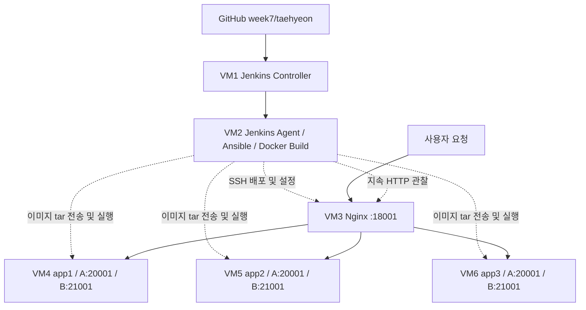
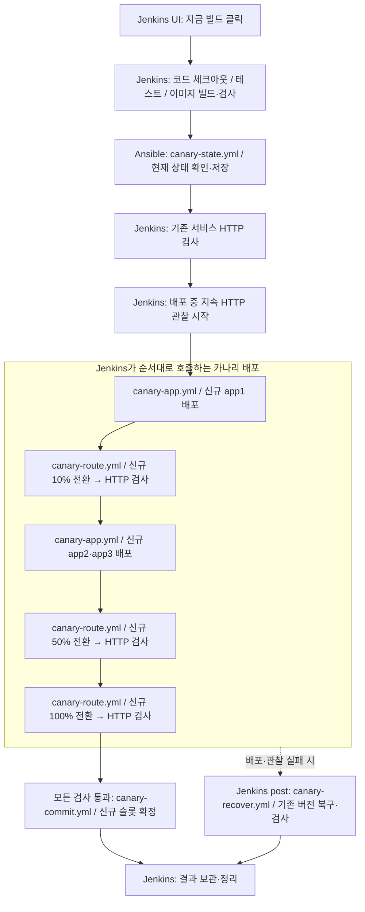
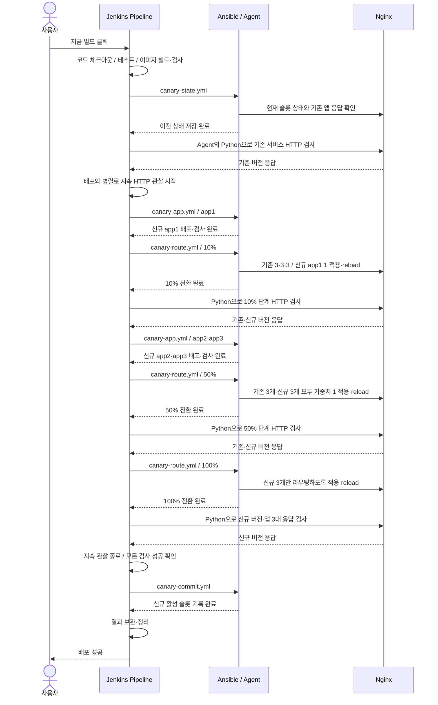
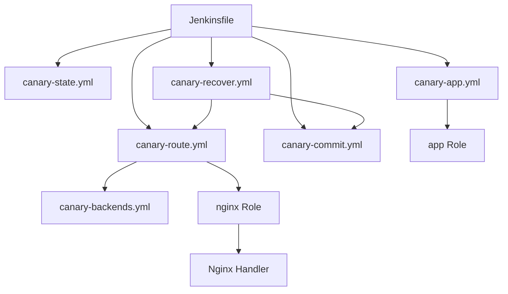

# Jenkins + Ansible 카나리 배포 정리

[PR #32](https://github.com/cloud-club/10th-jenkins-ansible-cicd-study/pull/32)에서 구현한 구조와 흐름을 정리한 문서입니다. [노션 발표 원고](https://app.notion.com/p/3f735308a3bb806494aad8fb3f24c320)를 바탕으로 작성했습니다.

## 구현 목표 및 배포 전략

앱 서버 3대에 Canary 배포를 구성했습니다. 기존 서비스를 유지하면서 비활성 슬롯에 새 버전을 배포하고, Nginx에서 신규 버전 트래픽을 10% → 50% → 100%로 늘립니다.

Jenkins가 단계와 실패 처리를 제어하고, Ansible이 슬롯·가중치 계산과 원격 배포를 수행합니다. Python은 HTTP 요청·응답 검증·집계만 담당합니다.

## 아키텍처

A/B는 같은 VM 안에서 실행되는 별도 컨테이너입니다. 처음에는 기존 20001을 A로 사용하고 신규 버전을 B 21001에 배포합니다. 성공 이후 다음 배포는 반대 슬롯을 사용합니다.

## 전체 실행 순서

Jenkins UI에서 **‘지금 빌드’**를 누르면 파이프라인이 아래 순서로 Ansible Playbook을 호출합니다. 단계별 HTTP 검사가 통과해야 다음 단계로 넘어갑니다.

### Playbook 호출 순서

위 시퀀스는 모든 검사를 통과하는 정상 경로입니다. 배포·관찰이 실패하면 Jenkins가 다음 단계를 중단하고, 복구 마커가 있는 경우 `post`에서 `canary-recover.yml`을 호출합니다.

**Jenkins는 순서와 성공·실패를 제어하고, Ansible은 서버 배포와 Nginx 설정 변경을 실행합니다.** HTTP 검사는 Agent에서 Python으로 실행하며, 지속 관찰은 카나리 배포와 병렬로 진행합니다. 복구는 트래픽 전환 전에 저장한 복구 마커가 있을 때 실행합니다.

위 그림은 구현된 전체 흐름이며, 실환경 검증은 10% 전환과 이후 기존 버전 복원까지 완료했습니다.

## A/B 슬롯으로 기존 버전 유지

각 앱 서버에는 컨테이너를 실행할 자리를 두 개씩 두었습니다. 이 자리를 슬롯이라고 부르고, A는 20001 포트, B는 21001 포트를 사용합니다. 앱 서버 3대 각각에서 기존 버전과 새 버전을 함께 실행할 수 있는 구조입니다.

예를 들어 지금 A에서 기존 버전이 서비스 중이면 B에 새 버전을 띄웁니다. **B 컨테이너를 실행했다고 바로 사용자 요청을 받는 것은 아닙니다.** 먼저 정상적으로 실행되는지 확인한 뒤 Nginx에서 트래픽을 보내기 시작합니다.

배포가 끝나면 B를 활성 슬롯으로 기록합니다. 다음 배포에서는 반대로 A에 새 버전을 올립니다. A와 B가 기존·신규 역할을 번갈아 맡는 방식입니다. 이전 버전은 문제가 생겼을 때 돌아갈 수 있도록 남겨 둡니다.

## 배포 전에 확인하는 것

먼저 코드를 체크아웃하고 빌드 번호와 커밋 SHA로 이번 배포를 구분합니다. 배포 로직과 Spring Boot 테스트를 실행한 뒤 JAR와 Docker 이미지를 만듭니다.

만든 이미지도 임시 컨테이너로 실행해서 `/health`와 `/version` 응답을 확인합니다. Ansible Playbook 문법 검사까지 통과해야 실제 서버 작업으로 넘어갑니다.

그다음 `canary-state.yml`로 현재 활성 슬롯과 앱 서버 3대의 상태를 확인하고 이전 상태를 저장합니다. 실패했을 때 복구할 기준입니다. Nginx를 거치는 기존 서비스 응답도 관찰한 뒤 배포를 시작합니다.

## 10% → 50% → 100%로 트래픽 전환

### app1에 새 버전을 올리고 10% 전환

처음에는 app1의 비활성 슬롯에만 새 버전을 올립니다. A가 운영 중이라면 app1의 B에 새 컨테이너를 띄우는 겁니다. 기존 app1·app2·app3의 A는 그대로 요청을 처리합니다.

새 컨테이너가 정상인지 확인하면 Ansible이 Nginx 가중치를 바꿉니다. 기존 컨테이너 3개는 각각 3, 신규 app1은 1로 설정합니다. 전체 합이 10이니까 기존 버전은 합쳐서 약 90%, 신규 app1은 약 10%를 받습니다.

이 상태에서 Python이 요청을 보내 오류가 없는지, 예상한 버전이 응답하는지, 신규 버전 비율이 맞는지 검사합니다. 검사를 통과하면 Jenkins가 다음 단계로 넘어갑니다.

### app2·app3에도 새 버전을 올리고 50% 전환

10% 관찰을 통과하면 app2와 app3의 비활성 슬롯에도 새 버전을 올립니다. 두 서버는 함께 배포 대상으로 지정합니다. 기존 슬롯이 계속 요청을 처리하므로 서버를 한 대씩 교체하는 `serial: 1`이 필수는 아닙니다.

**serial: 1은 언제 쓰나?**

Ansible이 대상 호스트를 한 대씩 작업하게 하는 설정입니다. 같은 서비스를 여러 서버로 늘린 스케일아웃 환경에서 롤링 배포할 때, 한 서버를 교체하는 동안 나머지 서버가 요청을 처리하도록 구성하는 데 사용합니다. 트래픽 제외·복귀는 별도로 구현해야 합니다.

**서로 다른 VM이어도 같은 서비스라면 동시 교체에 주의해야 합니다.** 현재 app1·app2·app3도 서로 다른 VM에서 같은 애플리케이션을 실행합니다. A/B 슬롯으로 기존 컨테이너를 유지하기 때문에 serial: 1이 필수는 아닙니다.

각 서버가 서로 다른 서비스를 담당한다면 복제 서버를 하나씩 교체하는 상황과는 다릅니다. 다만 서비스 간 호출 관계나 공유 DB가 있다면 배포 순서와 버전 호환성은 확인해야 합니다. serial: 1 자체가 다른 컨테이너를 보호하는 기능은 아닙니다.

이제 기존 컨테이너 3개와 신규 컨테이너 3개가 준비됩니다. Nginx 가중치를 모두 1로 바꾸면 신규 버전 전체가 약 50%의 트래픽을 받습니다. 이 단계에서도 응답을 관찰하고 검사합니다.

### 신규 버전으로 100% 전환

50% 관찰까지 통과하면 Nginx에서 기존 슬롯을 라우팅 대상에서 빼고 신규 슬롯에만 요청을 보냅니다. 이때 신규 버전 전체가 트래픽의 100%를 받습니다.

100% 전환 후에도 HTTP 응답을 검사합니다. 신규 앱 서버 3대가 모두 예상한 버전으로 응답하는지 확인한 뒤 배포를 확정합니다. **100%에서 무중단 배포를 시작하는 것이 아니라, 기존 서비스를 유지하며 비율을 늘리는 전체 과정이 무중단 배포를 목표로 합니다.**

### 단계별 트래픽 설정
| 단계 | 기존 슬롯 | 신규 슬롯 | 목표 비율 |
| --- | --- | --- | --- |
| 배포 전 | app1~3: 1/1/1 | 라우팅 제외 | 0% |
| Canary 10% | app1~3: 3/3/3 | app1: 1 | 10% |
| Canary 50% | app1~3: 1/1/1 | app1~3: 1/1/1 | 50% |
| Canary 100% | 라우팅 제외 | app1~3: 1/1/1 | 100% |
가중치는 분배 목표입니다. 짧은 구간의 실제 요청 비율이 항상 정확히 10%나 50%가 되는 것은 아닙니다.

### 배포 내내 관찰하는 작업도 함께 실행

지금 설명한 단계별 검사와 별개로, 배포하는 동안 계속 요청을 보내는 관찰 작업도 실행합니다. Jenkins의 `parallel`로 배포와 지속 관찰을 함께 돌립니다.

`observe.py stage`는 배포 전과 각 전환 후 일정 시간 동안 검사해서 다음 단계로 진행해도 되는지 판정합니다. `observe.py monitor`는 컨테이너를 준비하고 Nginx를 변경하는 동안에도 계속 요청을 보냅니다.

지속 관찰에서 잘못된 응답이나 허용 시간을 넘긴 응답이 나오면 실패합니다. 그러면 Jenkins의 `failFast`가 진행 중인 배포도 중단하도록 구성했습니다.

## 배포 성공 처리와 실패 시 복구

모든 트래픽 단계와 지속 관찰이 통과하면 `canary-commit.yml`로 신규 슬롯을 활성 슬롯으로 기록합니다. 다음 배포는 이 기록을 보고 반대 슬롯을 선택합니다.

실패에 대비해서 첫 트래픽 전환 직전에 `recovery-needed.json`에 이전 상태를 저장합니다. 이 마커가 있는 상태에서 실패하거나 중단되면 Jenkins의 `post { unsuccessful }`에서 `canary-recover.yml`을 실행합니다.

복구할 때는 기존 슬롯으로 트래픽과 상태를 되돌리고 HTTP 응답까지 확인합니다. 복구 검사를 통과해야 마커를 지웁니다. 복구가 실패하면 마커를 남기고 다음 실행에서 새 배포보다 복구를 먼저 처리합니다.

다만 **SSH 연결 자체가 끊기면 복구 작업도 실패할 수 있습니다.** 자동 복구는 이 절차를 실행하도록 만든 것이고, 모든 상황에서 복구 성공을 보장하는 것은 아닙니다. 관찰 결과와 복구 기록은 Jenkins Artifact로 남깁니다.

## 이 흐름을 Jenkinsfile에서 연결하는 방법

이제 앞에서 설명한 흐름이 코드에서 어떻게 연결되는지 보겠습니다.

Jenkinsfile 상단에는 공통 함수가 두 개 있습니다. `runCanaryPlaybook()`은 필요한 변수와 SSH 인증을 준비해서 Ansible Playbook을 실행합니다. `observeCanaryStage()`는 Python의 단계별 관찰 명령을 실행합니다.

실제 명령은 `ansible-agent`에서 실행합니다. Python도 이 Agent에서 Nginx로 HTTP 요청을 보냅니다. 복구 후 검사에서는 Ansible이 `delegate_to: localhost`로 같은 Agent에서 Python을 실행합니다.

같은 Job의 배포가 동시에 겹치지 않도록 설정했고, 단계별 관찰 시간과 최소 표본 수, 최대 응답 시간은 Jenkins 파라미터로 조정할 수 있게 했습니다.

## Ansible Playbook 연결 구조와 역할

Jenkinsfile에서 Playbook을 호출하면 Ansible이 필요한 Task와 Role, Handler를 실행합니다. 아래 그림에서 각 Playbook이 어떤 작업으로 이어지는지 볼 수 있습니다.

### Playbook과 Role을 분리한 이유

배포 순서는 Jenkins가 정하고, Playbook은 해당 단계에서 어떤 서버에 어떤 작업을 할지 정의합니다. Docker 컨테이너 배포나 Nginx 설정처럼 반복해서 실행하는 작업은 Role로 묶었습니다. 단계의 흐름과 실제 작업을 나눠서 코드를 따라가기 쉽게 했습니다.

- **Playbook:** `ansible/playbooks/canary-*.yml` — 해당 단계의 실행 대상과 작업을 정의

- **app Role:** `ansible/roles/app/` — Docker 이미지 전달, 비활성 슬롯 컨테이너 교체 및 상태 검증. **포인트:** `assert`로 활성 슬롯 변경 방지

- **nginx Role:** `ansible/roles/nginx/` — 백엔드 검증, Jinja2 템플릿 생성, Handler 호출. **포인트:** `meta: flush_handlers`로 Nginx 변경을 즉시 적용

- **공통 Task 파일:** `ansible/tasks/canary-backends.yml` — 슬롯·가중치 계산. **Role이 아닌 Task 목록:** `import_tasks` 등으로 호출

- **Handler:** `ansible/roles/nginx/handlers/main.yml` — Nginx 설정 교체·검증·reload 실행

### ① `canary-state.yml` — 기존 상태 확인

`canary-state.yml`은 현재 서비스 상태와 복구할 기준을 확인합니다. 저장된 상태 파일은 `ansible.builtin.slurp`로 읽고, 파일이 없으면 기존 week6 서비스가 있는 A 슬롯을 기준으로 검사합니다.

기존 앱 3대의 `/health`·`/version`을 검사한 뒤, 확인한 상태와 관찰 대상 목록을 Agent에 저장해 이후 트래픽 계산과 실패 시 복구에 사용합니다.

### ② `canary-app.yml` — 신규 버전 배포

`canary-app.yml`은 새 버전을 비활성 슬롯에 배포합니다. `active_slot`이 A면 `deploy_slot`은 B를 선택합니다. 실제 이미지 전달과 컨테이너 실행, 응답 검사는 app Role이 담당합니다.

Jenkins가 app1 또는 app2·app3를 대상으로 지정하며, 기존 활성 컨테이너는 유지한 채 반대 슬롯에 이미지를 올리고 예상한 버전으로 응답하는지 확인합니다.

### ③ `canary-route.yml` — Nginx 트래픽 변경

`canary-route.yml`은 이번 단계의 트래픽 설정을 적용합니다. `import_tasks`로 `canary-backends.yml`을 불러와 슬롯과 가중치를 계산하고, nginx Role이 대상 검사와 설정 파일 생성을 진행합니다. 변경이 있으면 Handler가 설정 적용 스크립트를 실행해서 문법 검사와 reload까지 처리합니다.

Jenkins가 전달한 10%·50%·100%에 맞춰 라우팅을 바꾸는 역할이며, 적용 후 실제 응답 비율이 맞는지는 Jenkins가 별도로 Python 관찰기를 실행해 확인합니다.

### ④ `canary-commit.yml` — 배포 확정

`canary-commit.yml`은 검증이 끝난 슬롯을 활성 상태로 기록합니다. 활성 슬롯과 릴리스 정보를 `state.json`에 저장해서 다음 배포의 기준으로 사용합니다.

트래픽을 직접 전환하는 작업은 아니며, B로 100% 전환과 검사가 끝났다면 ‘현재 활성 슬롯은 B’라고 기록해 다음 배포에서는 A를 선택하도록 합니다.

### ⑤ `canary-recover.yml` — 실패 시 복구

`canary-recover.yml`은 기존 슬롯으로 트래픽과 상태를 되돌립니다. `import_playbook`으로 라우팅과 상태 기록 Playbook을 다시 사용합니다. 마지막 HTTP 검사까지 통과하면 복구 마커를 삭제합니다.

Jenkins의 실패 후 처리에서 호출하며, SSH 오류 등으로 복구가 완료되지 않으면 마커를 남겨 다음 실행에서 새 배포보다 이전 상태 복구를 먼저 시도하도록 합니다.

## 고민한 점 — 카나리 버전을 따로 관찰해야 하는 이유

토스 SLASH 24의 [생산성과 안정성 모두 잡는 마스터키, Canary 배포 개선기](https://toss.im/slash-24/sessions/22)를 참고하면서, 트래픽을 조금씩 늘리는 것만큼 새 버전의 상태를 어떻게 확인할지도 중요하다고 생각했습니다.

MSA나 분산 환경에서는 요청 하나가 여러 서비스를 거칩니다. 오류가 발생해도 새로 배포한 서비스의 문제인지, 호출한 다른 서비스나 DB의 문제인지 바로 구분하기 어려울 수 있습니다. 그래서 카나리 버전을 기존 버전과 구분해서 관찰하고, 문제가 생겼을 때 요청의 흐름을 따라갈 수 있어야겠다고 생각했습니다.

현재 실습은 앱 서버 3대에 같은 애플리케이션을 배포하는 구조입니다. 여러 서비스를 연결한 MSA를 구현한 것은 아니지만, 분산 환경으로 확장할 때 필요한 관찰 방법도 함께 고민했습니다.

### 로그 수집

우선 문제가 발생한 시간과 서버, 배포 버전을 함께 확인할 수 있어야 합니다. 현재는 Python 관찰기가 요청 시간, 경로, HTTP 상태, 응답 내용, 오류, 응답 시간을 JSONL로 기록하고 Jenkins Artifact에 보관합니다. 응답에는 서버 이름과 릴리스 정보가 있어서 기존 버전과 신규 버전을 구분할 수 있습니다.

다음에는 이 관찰 기록에 앱 로그와 Nginx 로그도 연결하고 싶습니다. 로그마다 서비스명, 서버명, 슬롯, 릴리스 정보를 남기고 여러 서비스가 같은 요청 ID나 trace ID를 전달하면, 어느 요청이 어떤 서비스를 거쳐 실패했는지 추적하는 데 도움이 될 것 같습니다.

**현재 구현은 HTTP 관찰 기록의 수집·보관까지이며, 앱·Nginx 로그의 중앙 수집이나 분산 추적은 아직 구현하지 않았습니다.**

### 오류율 — 전체 평균보다 기존·카나리 버전을 나눠서 보기

카나리 버전이 전체 트래픽의 10%만 받는 상황에서는 신규 버전에서 오류가 나도 전체 평균에는 작게 보일 수 있습니다. 예를 들어 신규 버전의 오류율이 10%이고 기존 버전은 정상이라면, 전체 오류율은 약 1%입니다. 전체 수치만 보면 새 버전의 문제를 놓칠 수 있습니다.

그래서 **기존 버전과 카나리 버전의 오류율을 각각 계산하고 비교하는 방식**이 필요하다고 생각했습니다. 오류율뿐 아니라 응답 시간과 실제 업무 요청의 성공 여부도 같이 보고 싶습니다.

현재 관찰기는 HTTP 오류, 잘못된 응답, 버전 불일치, 응답 지연을 검사합니다. 하나라도 발생하면 실패 처리하는 엄격한 기준을 사용합니다. 집계한 실패 수에는 지연 초과와 응답 검증 실패도 포함되므로, 이를 HTTP 5xx 오류율과 같은 지표로 설명하지는 않아야 합니다.

향후에는 실제 서비스 요청을 대상으로 버전별 요청 수와 오류 수를 집계하고, 최소 표본 수와 관찰 시간을 확보한 뒤 기존 버전보다 얼마나 나빠졌는지 판단하도록 개선하고 싶습니다.

### 자동 롤백

관찰 결과를 사람이 확인하는 데서 끝내지 않고, 문제가 확인되면 트래픽 확대를 멈추고 기존 버전으로 돌아가도록 연결했습니다. 현재는 Python 검사가 실패하면 Jenkins가 후속 단계를 중단하고 Ansible로 기존 트래픽과 상태를 복구합니다.

향후 버전별 오류율을 수집하게 되면, **충분한 요청을 관찰한 상태에서 카나리 오류율이 기준을 일정 시간 넘으면 롤백하는 방식**도 고려할 수 있습니다. 일시적인 오류 하나 때문에 불필요하게 되돌아가지 않도록 관찰 시간, 최소 표본 수, 허용 오류율을 함께 정해야 합니다.

이번 실환경 검증에서는 SSH 연결이 끊기면서 최초 자동 복구도 실패했습니다. 자동 롤백 로직을 만드는 것뿐 아니라 복구 명령을 실행할 연결이 살아 있는지, 되돌린 뒤 서비스가 정상인지까지 확인해야 한다는 점을 배웠습니다.

## 마무리

이번에는 Jenkins가 순서를 진행하고 Ansible이 서버와 트래픽을 변경하도록 구성했습니다. Python은 실제 응답을 검사해서 다음 단계로 넘어갈 수 있는지 확인합니다. 이전 상태 저장과 복구 흐름도 만들었고, 실제 검증은 10% 전환과 이후 기존 버전 복원까지 확인했습니다.

---

[생산성과 안정성 모두 잡는 마스터키, Canary 배포 개선기](https://toss.im/slash-24/sessions/22)
