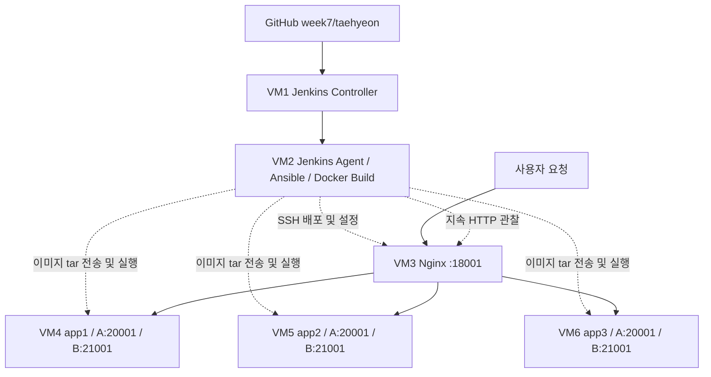
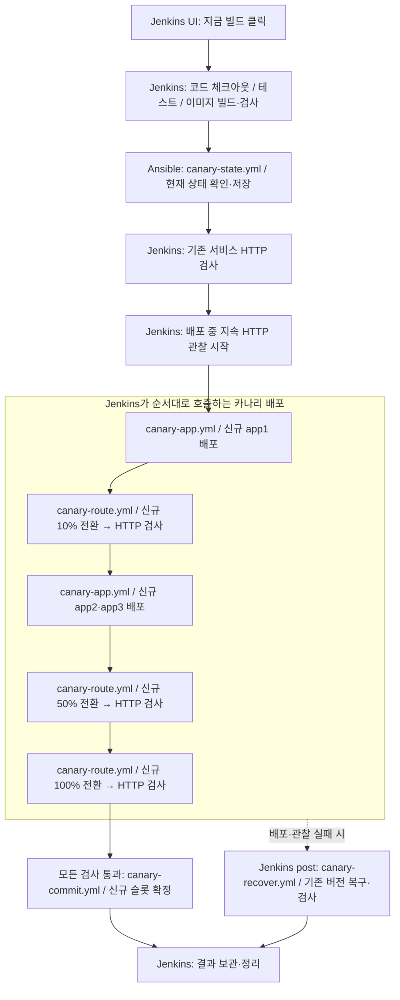
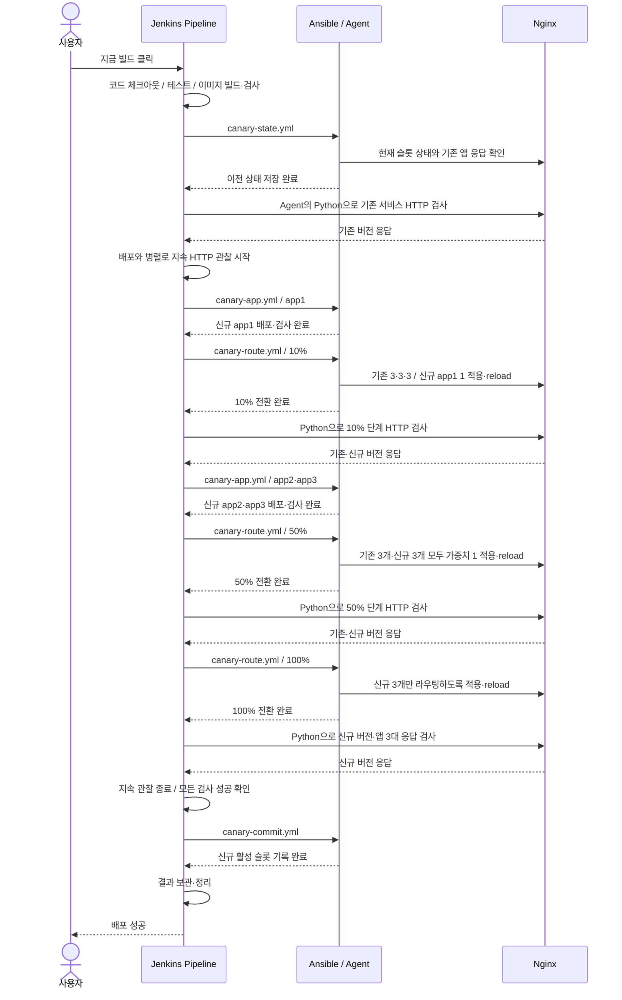

# Jenkins + Ansible 카나리 배포 정리

[PR #32](https://github.com/cloud-club/10th-jenkins-ansible-cicd-study/pull/32)의 배포 구조와 실행 흐름을 정리한 문서입니다. [노션 발표 원고](https://app.notion.com/p/3f735308a3bb806494aad8fb3f24c320)를 바탕으로 작성했습니다.

## 1. 목표와 아키텍처

앱 서버 3대에 같은 애플리케이션을 배포하고, 기존 서비스를 유지하면서 신규 버전의 트래픽을 10% → 50% → 100%로 늘리는 카나리 배포를 구성했습니다.

- **Jenkins**: 단계 실행, 성공·실패 판단, 복구 호출
- **Ansible**: 컨테이너 배포, 슬롯·가중치 계산, Nginx 설정 변경
- **Python**: HTTP 요청·응답 검증과 결과 집계

Ansible과 Python은 모두 Jenkins Agent에서 실행합니다. 사용자 요청은 Nginx `:18001`을 거쳐 앱 서버로 전달됩니다.

### 1-1. A/B 슬롯

슬롯은 각 앱 서버에서 컨테이너를 실행할 자리입니다. A는 `20001`, B는 `21001` 포트를 사용합니다. 서버를 추가하는 대신 같은 VM에서 기존·신규 컨테이너를 함께 실행합니다.

A가 운영 중이면 B에 신규 버전을 띄우고 검사한 뒤 트래픽을 보냅니다. 배포가 완료되면 B를 활성 슬롯으로 기록하고, 다음 배포에서는 A를 사용합니다. 이전 컨테이너는 복구용으로 남기며, 해당 슬롯을 다시 배포할 때 교체합니다.

## 2. 전체 실행 순서

Jenkins UI에서 **‘지금 빌드’**를 누르면 다음 순서로 진행합니다. 빌드 번호와 커밋 SHA로 릴리스를 식별하고, 배포 로직·앱 테스트, 이미지 실행 검사, Playbook 문법 검사를 통과한 뒤 서버 작업을 시작합니다.

### 2-1. Jenkins·Ansible·Nginx 호출 순서

시퀀스 다이어그램 보기

시퀀스는 정상 배포 경로입니다. 각 트래픽 전환 후에는 HTTP 검사를 통과해야 다음 단계로 넘어가며, 배포와 지속 관찰이 모두 성공해야 활성 슬롯을 확정합니다.

### 2-2. 단계별 트래픽

| 단계 | 기존 app1·2·3 가중치 | 신규 app1·2·3 가중치 | 신규 트래픽 목표 |
| --- | --- | --- | --- |
| 배포 전 | 1 / 1 / 1 | 제외 | 0% |
| Canary 10% | 3 / 3 / 3 | 1 / 제외 / 제외 | 10% |
| Canary 50% | 1 / 1 / 1 | 1 / 1 / 1 | 50% |
| Canary 100% | 제외 | 1 / 1 / 1 | 100% |

10% 단계에서는 신규 app1만 요청을 받습니다. 검사를 통과하면 app2·app3에도 신규 버전을 준비하고 50%로 확대합니다. 100%에서는 신규 앱 3대만 요청을 받습니다.

가중치는 전체 합에 대한 분배 목표이므로 짧은 구간의 실측 비율이 항상 정확히 일치하지는 않습니다. 기존 서비스를 유지하며 이 비율을 늘리는 전체 과정이 무중단 배포를 목표로 합니다.

## 3. Jenkins 실행과 HTTP 관찰

`runCanaryPlaybook()`은 SSH 인증과 변수를 준비해 Ansible을 실행하고, `observeCanaryStage()`는 Python의 단계별 관찰을 실행합니다. 같은 Job의 동시 배포를 막았으며 관찰 시간·최소 표본 수·최대 응답 시간은 Jenkins 파라미터로 조정합니다.

| 관찰 모드 | 실행 구간 | 역할 |
| --- | --- | --- |
| `observe.py stage` | 배포 전, 10%·50%·100% 전환 후 | 기본 60초 동안 응답·트래픽 비율·표본 수·대상 서버를 검사 |
| `observe.py monitor` | 카나리 배포와 `parallel`로 실행 | 컨테이너 준비와 Nginx 변경 중에도 연속 요청으로 오류·지연 감지 |

현재는 관찰 요청에서 HTTP 오류, 잘못된 응답·버전, 허용 시간을 넘긴 응답이 하나라도 나오면 실패합니다. 지속 관찰이 실패하면 `failFast`로 배포 분기도 중단합니다. **오류율이 일정 비율을 넘을 때까지 기다리는 방식은 아닙니다.**

## 4. Playbook별 역할

Jenkins가 호출 순서를 정하고, Playbook은 대상과 작업을 정의합니다. 반복 작업은 app·nginx Role로 묶었습니다. 아래 경로는 `practice/taehyeon/` 기준입니다.

### 4-1. `canary-state.yml` — 기존 상태 확인

Nginx VM의 상태 파일을 `slurp`로 읽고, 없으면 week6의 기존 A 슬롯을 기준으로 앱 3대의 `/health`·`/version`을 검사합니다. 확인한 이전 상태와 관찰 대상 목록을 Agent에 저장해 트래픽 계산과 복구에 사용합니다.

### 4-2. `canary-app.yml` — 신규 컨테이너 준비

현재 활성 슬롯의 반대 슬롯을 선택하고, Jenkins가 지정한 app1 또는 app2·app3에 app Role을 실행합니다. 기존 활성 컨테이너를 유지하면서 이미지를 전달·로드하고 신규 컨테이너의 상태와 릴리스를 검사합니다.

### 4-3. `canary-route.yml` — 트래픽 변경

`ansible/tasks/canary-backends.yml`로 슬롯과 가중치를 계산하고 nginx Role로 대상 검사와 설정 생성을 수행합니다. 변경이 있으면 Handler를 즉시 실행해 공유 잠금 안에서 설정 교체·문법 검사·reload를 처리합니다. 실제 HTTP 분배 검사는 Jenkins가 별도로 실행합니다.

### 4-4. `canary-commit.yml` — 활성 상태 기록

검증이 끝난 슬롯과 릴리스를 `state.json`에 원자적으로 저장합니다. **트래픽을 전환하는 작업이 아니라 완료된 전환을 기록하는 작업**이며, 다음 배포는 이 파일을 읽고 반대 슬롯을 선택합니다.

### 4-5. `canary-recover.yml` — 기존 버전 복원

`import_playbook`으로 라우팅과 상태 기록 Playbook을 재사용해 이전 트래픽과 활성 상태를 복원합니다. 이후 `delegate_to: localhost`로 Agent에서 Python 검사를 실행하고, 통과한 경우에만 복구 마커를 지웁니다.

## 5. 실패 시 복구

첫 10% 전환 직전에 `recovery-needed.json`에 이전 상태를 저장합니다. 이후 배포·관찰이 실패하거나 실행이 중단되면 Jenkins의 `post { unsuccessful }`에서 복구를 호출합니다.

1. Nginx 트래픽을 이전 슬롯 100%로 되돌립니다.
2. 활성 슬롯과 릴리스 기록을 이전 상태로 복원합니다.
3. 기존 버전과 앱 3대의 HTTP 응답을 검사합니다.
4. 통과하면 마커를 삭제하고, 실패하면 유지합니다. Job은 복구 성공 여부와 관계없이 실패 상태로 남습니다.

복구는 신규 컨테이너를 종료하지 않고 트래픽만 차단합니다. 마커가 남아 있으면 다음 실행에서 새 배포를 막고 복구부터 시도합니다. 첫 전환 전에 실패하면 마커가 없으므로 이 복구 절차를 실행하지 않습니다.

**SSH 연결이 끊기면 자동 복구도 실패할 수 있습니다.** 관찰 결과와 복구 기록은 Jenkins Artifact로 보관합니다.

## 6. `serial: 1`과의 차이

`serial: 1`은 Ansible이 호스트를 한 대씩 작업하게 하는 설정이며, 다른 컨테이너를 보호하는 기능은 아닙니다. 같은 서비스를 스케일아웃한 환경에서 한 서버를 교체하는 동안 나머지가 요청을 처리하는 롤링 배포에 유용합니다. 트래픽 제외·복귀는 별도로 구현해야 합니다.

현재 app1·2·3도 서로 다른 VM이지만 같은 서비스의 복제본입니다. 기존 슬롯을 유지한 채 신규 슬롯을 준비하므로 `serial: 1`이 필수는 아닙니다. 서로 다른 서비스를 배포하는 경우에도 호출 관계와 공유 DB가 있다면 배포 순서·버전 호환성을 확인해야 합니다.

## 7. 고민한 점과 개선 방향

토스 SLASH 24의 [Canary 배포 개선기](https://toss.im/slash-24/sessions/22)를 참고하며, 트래픽 확대뿐 아니라 신규 버전의 상태를 구분해서 관찰하는 방법을 고민했습니다.

MSA·분산 환경에서는 요청이 여러 서비스를 거쳐 장애 원인을 바로 찾기 어려울 수 있습니다. 현재 실습은 같은 애플리케이션의 복제본 3대이며, 다음 항목은 여러 서비스로 확장할 때의 개선 방향입니다.

### 7-1. 로그 수집과 요청 추적

현재 관찰기는 시간, 경로, HTTP 상태, 응답 내용, 오류, 응답 시간을 JSONL로 기록합니다. 응답의 서버명·릴리스로 요청을 처리한 버전을 구분합니다.

향후 앱·Nginx 로그를 함께 수집하고 서비스명·서버명·슬롯·릴리스를 남기고 싶습니다. 요청 ID나 trace ID를 서비스 간에 전달하면 실패한 요청의 흐름을 추적하는 데 도움이 됩니다. 중앙 로그 수집과 분산 추적은 아직 구현하지 않았습니다.

### 7-2. 버전별 오류율 비교

신규 버전이 트래픽의 10%를 받고 그중 10%에서 오류가 나면, 기존 버전이 정상일 때 전체 오류율은 약 1%입니다. 전체 평균에 문제가 가려지지 않도록 기존·신규 버전별 오류율과 응답 시간을 비교할 필요가 있습니다.

현재 집계의 실패 수에는 HTTP 오류 외에 지연 초과와 응답 검증 실패도 포함됩니다. 향후에는 실제 업무 요청의 버전별 요청 수·오류 수를 수집하고, 충분한 표본과 관찰 시간을 확보한 뒤 판단하도록 개선하고 싶습니다.

### 7-3. 자동 롤백 기준과 실행 가능성

향후에는 카나리 오류율이 기준을 일정 시간 넘을 때 롤백하도록 최소 표본 수·관찰 시간·허용 오류율을 함께 정할 수 있습니다.

이번에는 SSH 연결 문제로 최초 자동 복구도 실패했습니다. 롤백 기준뿐 아니라 복구 명령을 실행할 연결이 살아 있는지, 되돌린 서비스가 정상인지까지 확인해야 한다는 점을 배웠습니다.

## 8. 실제 검증 범위

실환경에서는 **10% 트래픽 전환과 이후 기존 버전 복원까지 확인**했습니다. 50%·100% 전환은 아직 실환경 미검증이며, SSH 연결 안정화와 전체 승격·복구 재검증이 남아 있습니다.
