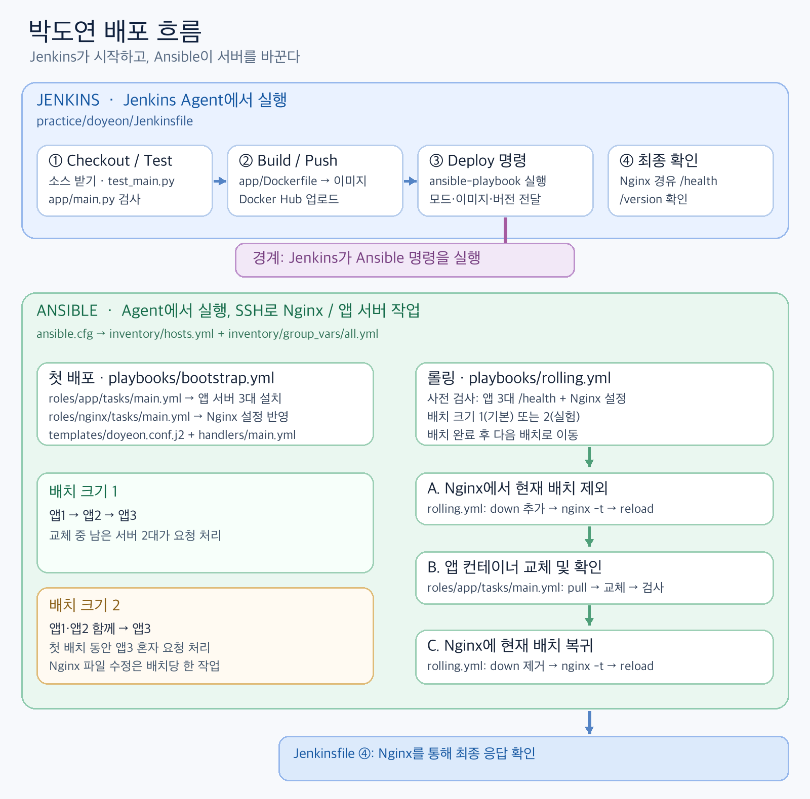
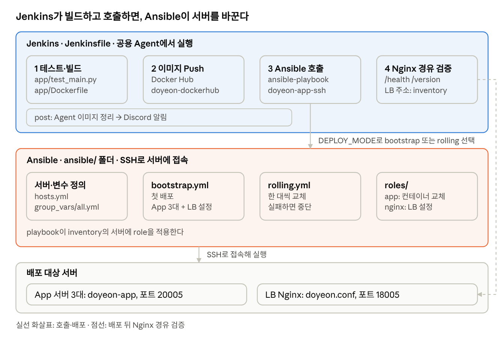
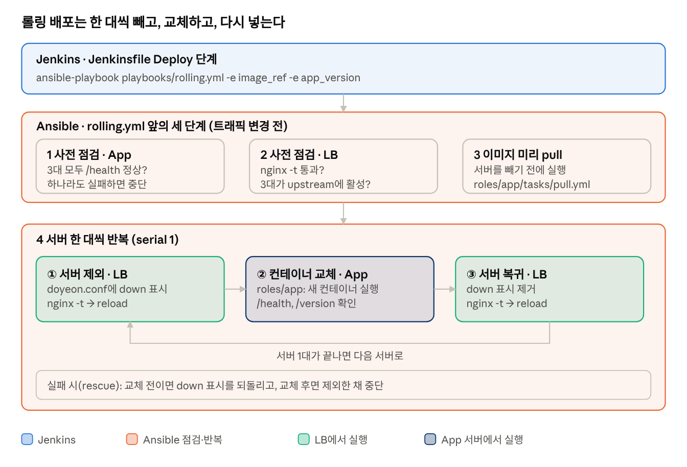
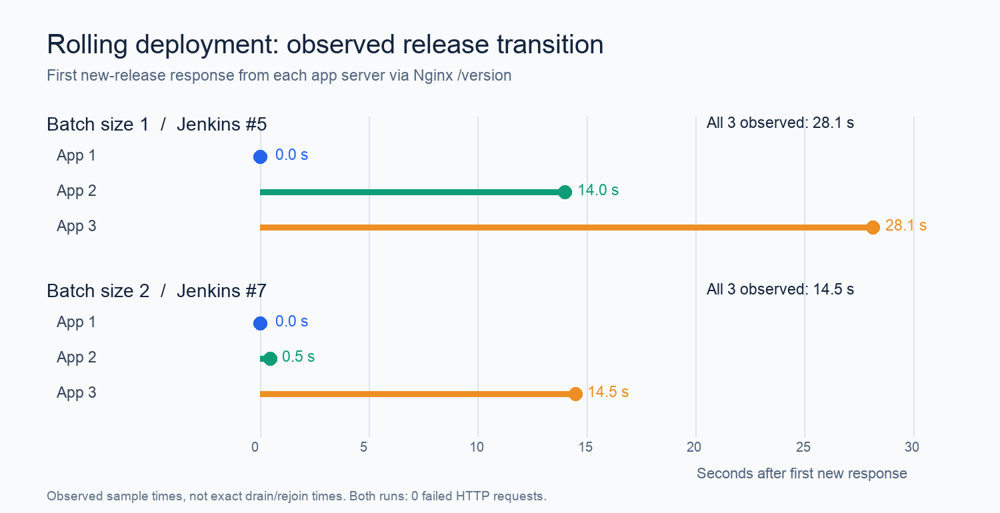
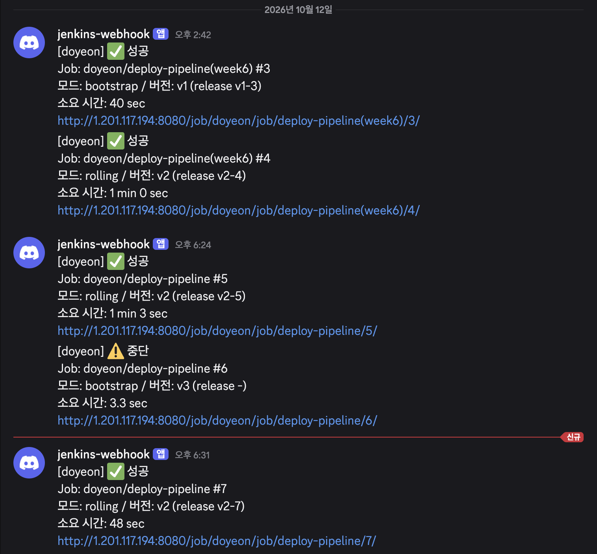
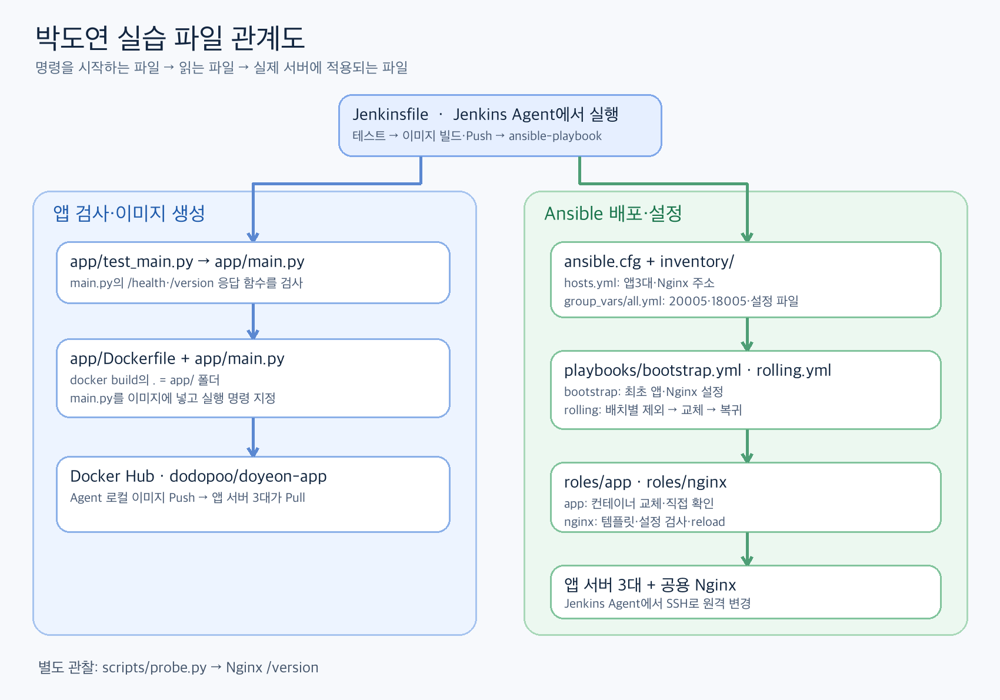
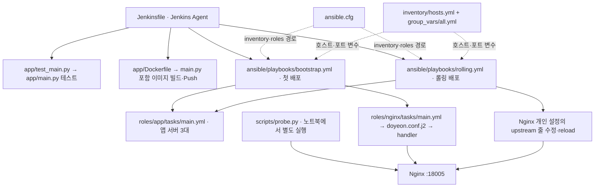

# 7주차 실습 보고서 — Jenkins·Ansible 롤링 배포

- 작성자: 박도연
- 실습일: 2026-10-12
- 과제 범위: 문서상 **1주차 기본 CI/CD**를 바탕으로 **2주차 무중단 배포 전략** 구현·검증 (실제 스터디 진행 시점은 7주차)
- 실행 코드: 1대씩 #5는 [`1443979`](https://github.com/cloud-club/10th-jenkins-ansible-cicd-study/commit/1443979b679899e9d721e28088de2b787a705cfb), 2대씩 #7은 [`0531774`](https://github.com/cloud-club/10th-jenkins-ansible-cicd-study/commit/0531774c1caf9a9841f2203b849f4aa6411e6f74)

## 1. 목표와 구성

목표는 앱 서버 3대를 한꺼번에 중단하지 않고 새 릴리스로 교체하는 것이다. Jenkins가 테스트·이미지 빌드·Push·배포 명령을 맡고, Ansible이 SSH로 Nginx와 앱 서버를 변경한다.

| 구성 요소 | 실습에서 맡은 일 |
| --- | --- |
| Jenkins Controller / Agent | 개인 Job 실행 / 테스트·빌드·Ansible 실행 |
| Docker Hub | `dodopoo/doyeon-app:<release>` 이미지 전달 |
| Nginx | `1.201.116.156:18005`에서 앱 서버 3대로 요청 분산 |
| 앱 서버 3대 | 각 서버의 `20005` 포트에서 도연 앱 컨테이너 실행 |

공용 서버에서는 개인 Jenkins Job, 컨테이너 `doyeon-app`, Nginx 설정 `/etc/nginx/conf.d/doyeon.conf`, 할당 포트만 사용했다. 아래 그림은 **Jenkins가 Ansible을 호출하고 Ansible이 서버를 변경하는 경계**를 보여준다.



## 2. 구현한 배포 흐름

아래 구조도는 **Jenkins 단계(파랑)와 Ansible 파일(주황)**을 구분한다. `Jenkinsfile`은 테스트·빌드·Push·Ansible 호출·Nginx 경유 검증을 맡고, `ansible/`의 playbook과 role이 서버를 변경한다. `DEPLOY_MODE`가 `bootstrap.yml` 또는 `rolling.yml`을 선택한다. 점선은 배포 후 검증 경로다. 그림의 `LB 주소: inventory`는 현재 로컬 작업본 기준이며 #5·#7 당시에는 주소가 Jenkinsfile에 직접 적혀 있었다.



기본 배포는 [`Jenkinsfile`](../../../practice/doyeon/Jenkinsfile)의 `bootstrap` 모드가 [`bootstrap.yml`](../../../practice/doyeon/ansible/playbooks/bootstrap.yml)을 실행한다. Python 테스트 후 이미지를 빌드·Push하고, 앱 서버 3대에 컨테이너를 배포·검증한 다음 개인 Nginx 설정을 반영한다. Nginx 설정을 처음 적용하거나 변경했을 때는 `nginx -t`로 검사하고 reload해야 새 설정이 요청 처리에 반영된다.

롤링 배포는 같은 Jenkins Job에서 `DEPLOY_MODE=rolling`을 선택해 [`rolling.yml`](../../../practice/doyeon/ansible/playbooks/rolling.yml)을 실행한다. 핵심 순서는 다음과 같다.

1. 배포 전 앱 서버 3대의 직접 `/health`와 Nginx upstream의 정상 상태를 검사한다.
2. 현재 배치를 Nginx upstream에서 `down` 처리하고 `nginx -t` 후 reload한다.
3. 해당 배치의 `doyeon-app` 컨테이너를 새 이미지로 교체한다. 각 서버의 직접 `/health`·`/version`으로 상태, 버전, 릴리스, 응답 서버를 확인한다.
4. 검증을 통과한 배치를 upstream에 복귀시키고 다시 `nginx -t`와 reload를 수행한다.
5. 다음 배치에 같은 작업을 반복한 뒤 Jenkins가 Nginx 경유 `/health`·`/version`을 최종 확인한다.

아래 그림은 `rolling.yml`의 사전 점검과 서버별 반복을 Jenkins·Ansible 구분과 함께 나타낸 것이다. 초록 상자는 LB에서, 남색 상자는 앱 서버에서 실행되는 작업이다. **그림의 3번 "이미지 미리 pull"과 하단의 실패 시 `down` 표시 복구는 현재 로컬 작업본의 동작**이며 #5·#7 실행에는 없었다(아래 실패 처리 시험 참고).



#5 당시에는 `serial: 1`로 앱1 → 앱2 → 앱3을 교체했다. #7 코드에 추가된 `ROLLING_BATCH_SIZE=2`는 **앱1·앱2를 함께 제외·교체·복귀**한 뒤 앱3을 교체한다. #7에서는 Nginx 설정 파일 수정이 배치당 한 작업으로 순차 실행되므로 두 서버의 작업이 같은 파일을 동시에 덮어쓰지 않는다. 앱 컨테이너 교체와 직접 검사는 배치 안에서 병렬로 실행된다.

## 3. 실행과 관측 결과

배포 전후 [`probe.py`](../../../practice/doyeon/scripts/probe.py)로 Nginx `/version`을 약 0.2초 간격으로 3분간 호출했다. CSV에는 시각, HTTP 상태, `version`, `release`, 응답 `instance`, 오류를 저장해 **어느 서버가 어떤 릴리스로 응답했는지** 확인했다.

| 실행 | 파라미터·릴리스 전환 | 요청 결과 | 첫 새 응답부터 마지막 서버의 첫 새 응답까지 |
| --- | --- | ---: | ---: |
| [Jenkins #5](http://1.201.117.194:8080/job/doyeon/job/deploy-pipeline/5/console), 1대씩·`1443979` | `v2-4 → v2-5` | 758건 중 HTTP 200 **758건**, 실패 0건 | **28.2초** |
| [Jenkins #7](http://1.201.117.194:8080/job/doyeon/job/deploy-pipeline/7/console), 2대씩·`0531774` | `v2-5 → v2-7` | 762건 중 HTTP 200 **762건**, 실패 0건 | **14.5초** |



2대씩 처리한 #7에서는 Jenkins 로그에 앱1·앱2가 같은 배치에서 제외·검증·복귀하고, 이어서 앱3이 처리된 순서가 남았다. 새 릴리스의 첫 응답은 앱1 **18:31:24.790**, 앱2 **18:31:25.259**, 앱3 **18:31:39.270 KST**에 관측됐다. #7의 마지막 Nginx 경유 검증도 `v2-7`을 반환했고 Pipeline은 `SUCCESS`로 종료됐다. 상세 작업 시각은 [Jenkins #7 Console Output](http://1.201.117.194:8080/job/doyeon/job/deploy-pipeline/7/console)에서 확인할 수 있다.

첫 새 응답부터 마지막 서버의 첫 새 응답까지의 구간은 2대씩 실행이 약 **48.6% 짧았다**. Jenkins 전체 빌드 시간이나 트래픽 제외 시간과는 다르다. **#5와 #7은 코드 커밋도 달라** 배치 크기만의 효과로 단정할 수 없다.

원본 요청 기록: [배치 1 CSV](rolling-run-20261012-v2.csv) · [배치 2 CSV](rolling-run-20261012-batch2.csv)

### Discord 웹훅으로 확인한 빌드 결과

Jenkinsfile의 `post`에서 성공·실패·중단 상태를 Discord 웹훅으로 보낸다. 아래는 사용자가 제공한 실제 알림 화면이다. 이 화면의 **소요 시간은 Jenkins 빌드 전체 시간**이며, 위 그래프의 **서버별 새 릴리스 관측 간격**과 기준이 다르다.

알림은 플러그인 없이 `curl`로 호출한다. 웹훅 URL은 Jenkins Folder의 `Secret text` Credential(`doyeon-discord-webhook`)에 두고 코드나 저장소에는 쓰지 않는다. JSON은 셸 문자열을 이어 붙이지 않고 Python `json.dumps`로 만들어 Job 이름의 괄호·따옴표에도 깨지지 않게 했고, `allowed_mentions`로 `@everyone` 같은 호출을 막았다. `try/catch`와 `|| true`로 감싸 알림이 실패해도 빌드 결과는 바뀌지 않는다.



| Job·빌드 | 모드·버전 | 웹훅 결과 | 전체 빌드 시간 |
| --- | --- | --- | ---: |
| `deploy-pipeline(week6)` #3 | bootstrap · `v1-3` | 성공 | 40초 |
| `deploy-pipeline(week6)` #4 | rolling · `v2-4` | 성공 | 1분 0초 |
| `deploy-pipeline` #5 | rolling · `v2-5` | 성공 | 1분 3초 |
| `deploy-pipeline` #6 | bootstrap · v3, 릴리스 미생성 | 중단 | 3.3초 |
| `deploy-pipeline` #7 | rolling · `v2-7` | 성공 | 48초 |

#3의 v1 첫 배포와 #4의 v2 롤링 성공 알림은 **v1에서 v2로 배포를 진행한 기록**이다. 다만 이 스크린샷만으로 그 전환 중 HTTP 요청이 한 번도 실패하지 않았다고 판단할 수는 없다. 이 보고서의 연속 요청 CSV는 뒤의 `v2-4→v2-5`, `v2-5→v2-7` 실행에서 수집했다. Job 이름에 `(week6)`이 붙은 #3·#4와 이후 `deploy-pipeline` #5·#7은 화면상 서로 다른 Job 기록이므로 빌드 번호를 혼동하지 않는다.

### 실패 처리 시험 (로컬 실행)

#5·#7에는 실패 시나리오가 없었다. "실패 시 후속 배포 중단"을 확인하려고 **노트북에서 `ansible-playbook`을 내 Nginx 설정과 컨테이너가 있는 실제 서버에 직접 실행**했다. 근거는 실행 출력, 컨테이너 시작 시각, `doyeon.conf`, LB 응답이다. 시험 전 설정을 백업하고 뒤에 `diff`로 복구를 확인했다. 시험 1·2는 로컬 수정 전, 시험 3·4는 수정 뒤 작업본으로 실행했다.

| 시험 | 방법 | 확인된 결과 |
| --- | --- | --- |
| 1. 새 버전 검증 불일치 | `-e app_version=v9`처럼 일부러 틀리게 지정 | 첫 서버(app1)의 `Verify the exact version` 단계에서 중단(`rescued=1`). app2·app3은 사전 점검만 수행했고 컨테이너 시작 시각이 그대로였다. app1은 `down`으로 남아 LB 응답은 app2·app3만 처리했다 |
| 2. 실패 상태에서 재실행 | app1이 `down`인 채 같은 playbook을 다시 실행 | 사전 점검의 `Require exactly one enabled line`에서 거부(해당 줄 `grep` 결과 0). 어떤 서버도 바뀌지 않았다(`changed=0`) |
| 3. 존재하지 않는 이미지 태그 | 없는 태그로 실행 | 서버를 제외하기 **전**의 pull 단계에서 3대 모두 실패해 중단. `doyeon.conf`가 시험 전 백업과 동일했다 |
| 4. 제외 직후 `nginx -t` 실패 | 시험용 복사본에서 검사 명령을 `nginx -t -c /nonexistent.conf`로 바꿔 강제 실패 | `down` 표시를 자동으로 되돌리고 reload한 뒤 "컨테이너 교체 전에 중단" 메시지로 종료. 설정이 백업과 동일했고 LB가 3대 모두에서 응답했다 |

시험 1은 설계대로 검증되지 않은 서버를 제외한 채 멈추므로, 그 뒤 `down` 줄은 수동으로 되돌렸다(`doyeon.conf` 백업과 `diff`로 확인). 시험 중 공용 Nginx reload는 시험 1에서 제외 1회와 복구 1회, 시험 4에서 복구 1회가 있었다.

## 4. 파일 관계: 무엇이 무엇을 호출하는가

아래 트리는 **현재 로컬 파일 위치**, 화살표는 **실행·참조 관계**를 보여준다. 명령과 Ansible은 Jenkins Agent에서 실행되고, Ansible이 SSH로 서버에 접속한다. `pull.yml`은 #5/#7 이후 추가된 로컬 작업본이다.



```text
practice/doyeon/
├── Jenkinsfile                         Jenkins 파이프라인의 시작점
├── app/
│   ├── main.py                         실제 배포되는 HTTP 앱 코드
│   ├── test_main.py                    main.py의 응답 함수를 검사하는 테스트
│   └── Dockerfile                      main.py를 이미지에 복사해 실행
├── ansible/
│   ├── ansible.cfg                     inventory와 roles 경로 지정
│   ├── inventory/
│   │   ├── hosts.yml                   앱 서버 3대와 Nginx 호스트 정의
│   │   └── group_vars/all.yml          개인 포트·컨테이너명·Nginx 파일 경로
│   ├── playbooks/
│   │   ├── bootstrap.yml               최초 앱 배포 + Nginx 설정
│   │   └── rolling.yml                 배치별 제외 → 교체 → 복귀
│   └── roles/
│       ├── app/tasks/main.yml          컨테이너 교체·직접 검증
│       ├── app/tasks/pull.yml          이미지 확인·pull (현재 로컬 작업본)
│       └── nginx/
│           ├── tasks/main.yml          개인 Nginx 설정 적용·검사
│           ├── templates/doyeon.conf.j2  upstream·listen 설정 원본
│           └── handlers/main.yml       검증 뒤 Nginx reload
└── scripts/probe.py                    Jenkins 밖에서 별도로 돌린 연속 요청 기록기
```



실행 경로를 파일명으로 다시 쓰면 다음과 같다.

1. [`Jenkinsfile`](../../../practice/doyeon/Jenkinsfile)이 `test_main.py`를 실행한다. 테스트는 `main.py`의 응답 자료를 검사한다.
2. 같은 파일이 `app/`을 Docker 빌드 컨텍스트로 지정한다. Dockerfile의 `COPY main.py`가 앱 코드를 이미지에 넣고, 그 이미지를 Docker Hub에 Push한다.
3. `Jenkinsfile`의 Deploy stage가 `ansible-playbook playbooks/$DEPLOY_MODE.yml`을 실행한다. `ansible.cfg`가 `inventory/hosts.yml`과 `roles/` 위치를 알려준다. `group_vars/all.yml`의 `20005`, `18005`, 컨테이너명도 이때 적용된다.
4. `bootstrap.yml` 또는 `rolling.yml`의 `hosts: app_servers`는 inventory의 `doyeon_app1`~`doyeon_app3`을 선택한다. `roles: - app` 또는 `include_role: name: app`은 `roles/app/tasks/main.yml`을 찾아 실행한다.
5. 최초 배포의 `bootstrap.yml`은 `roles/nginx/tasks/main.yml`을 통해 `doyeon.conf.j2`를 개인 설정 파일로 렌더링하고 handler가 reload한다. 롤링 배포의 `rolling.yml`은 이 **이미 설치된 파일**의 해당 upstream 줄만 배치별로 수정한다.
6. 배포 후 `Jenkinsfile`이 Nginx 경유 API를 최종 확인한다. `probe.py`는 배포 명령을 내리지 않는 별도 관찰 도구다.

## 5. 헷갈렸던 개념을 실행 흐름으로 묶어 보기

### 5.1 Jenkins는 순서를 정하고, Agent는 명령을 실행한다

[`Jenkinsfile`](../../../practice/doyeon/Jenkinsfile)은 Groovy 기반 Pipeline이다. Jenkins Controller가 Job과 빌드를 관리하고, `agent { label 'ansible-agent' }`로 선택된 **Jenkins Agent**에서 `sh`의 테스트·Docker·Ansible 명령이 실행된다. 여기서 `ansible-agent`는 Jenkins 노드의 라벨이다. 앱 서버에 Ansible Agent 프로그램이 깔려 있다는 뜻이 아니다.

`parameters`는 **빌드 실행 화면에서 받는 입력**이고, `environment`는 **이후 셸 명령에도 전달할 변수**다. 그래서 `APP_VERSION`과 `DEPLOY_MODE`가 두 곳에 보인다. `env.RELEASE_ID`는 빌드 번호가 정해진 뒤 `script`에서 `v2-7`처럼 계산해 설정한다. 정적인 값이라면 `environment`에 둘 수 있지만, 이 값은 입력 검증과 빌드 번호를 거쳐 만들어진다.

새 파라미터를 추가한 Jenkinsfile을 **처음 실행하는 빌드**에서는 `parameters`가 아직 Job에 등록되지 않는다. 이때 Groovy의 `params.APP_VERSION`은 기본값 `v1`을 돌려주지만 셸 환경변수 `$APP_VERSION`은 설정되지 않는다. 이 Job의 첫 빌드(`v1-1`)에서 `--build-arg APP_VERSION=`와 `-e app_version=`가 빈 값으로 들어가 컨테이너가 버전 없이 배포됐고, 마지막 Nginx 경유 검증이 `KeyError: 'APP_VERSION'`으로 실패했다. 두 번째 빌드(`v1-2`)에서는 정상이었다. `environment { APP_VERSION = "${params.APP_VERSION}" }`처럼 파라미터를 환경변수로 명시하면 첫 빌드에서도 값이 들어가므로, 파라미터를 새로 추가할 때마다 `environment`에 함께 등록한다.

비슷한 함정이 하나 더 있다. Groovy의 `'''` 문자열은 안에 쓴 `\n`을 먼저 줄바꿈으로 해석하므로, Discord 알림용 Python 코드를 그 안에 넣을 때는 `"\\n".join(...)`처럼 `\\n`으로 써야 Python이 `\n`으로 받는다. 그대로 쓰면 Python 문자열 중간에 실제 줄바꿈이 들어가 문법 오류가 난다. 로컬에서 Groovy의 이스케이프 처리를 흉내 내 Python을 실행해 검증했다.

전체 순서는 Jenkins의 `stage`·`steps`가 정한다. Deploy stage의 `ansible-playbook` 호출부터는 Ansible의 `play`·`task`·`role`이 원격 서버 작업을 정한다. Jenkins Agent가 **제어 노드**가 되어 SSH로 Nginx와 앱 서버에 접속하므로 앱 서버에는 Ansible 자체를 설치할 필요가 없다.

인증도 필요한 작업 범위에서 사용한다. #7의 Push stage는 `withCredentials`로 Docker Hub 로그인 토큰을 받고, Deploy stage는 `sshagent`로 SSH 키를 제공한다. `DOCKER_CONFIG="$WORKSPACE/.doyeon-docker-config"`는 Docker 로그인 설정을 공용 Agent의 기본 위치가 아닌 **이 Job의 Workspace 폴더**에 저장하도록 지정한다. Push 후 logout하고 마지막에 폴더를 정리한다. 현재 로컬 작업본에는 이미지 계정명을 얻는 Credential 블록이 빌드 앞에도 추가됐지만 #7 실행에는 포함되지 않았다.

### 5.2 Ansible은 배치별로 Nginx 트래픽과 컨테이너를 바꾼다

`serial: 1`은 앱 서버를 한 대씩, `serial: 2`는 앱1·앱2를 한 배치로 처리한다. 2대 배치에서 앱 컨테이너 작업은 병렬로 실행되지만 Nginx 설정 파일은 공용이므로 `run_once`가 `ansible_play_batch`의 서버 두 줄을 **한 작업 안에서 차례로 수정**한다. 이렇게 해야 앱1과 앱2 작업이 같은 파일을 동시에 덮어쓰지 않는다.

시작 전 `grep -Fxc "    server 1.201.118.202:20005;" /etc/nginx/conf.d/doyeon.conf`처럼 각 앱 서버의 **활성 upstream 줄이 정확히 1개**인지 확인한다. `-F`는 문자열 그대로, `-x`는 줄 전체, `-c`는 개수다. 이미 `down;`이 붙었거나 줄이 없거나 중복이면 롤링을 시작하지 않는다. 이 검사는 템플릿의 공백 형식에도 의존한다.

배치의 줄에 `down`을 추가한 뒤 `nginx -t`와 reload를 해야 Nginx가 그 서버로 새 요청을 보내지 않는다. 컨테이너 교체·직접 검사가 끝나면 `down`을 제거하고 다시 검사·reload한다. 최초 배포의 `bootstrap.yml`도 새 개인 설정 파일을 Nginx에 적용하려고 reload한다. 개인 포트는 분리돼 있어도 **Nginx 프로세스 자체는 공용**이므로 동시 변경과 전체 설정 검사를 신경 써야 한다.

reload의 범위와 횟수도 공용 환경에서는 비용이다. Nginx는 `conf.d/*.conf`를 하나의 설정으로 합쳐 읽으므로 reload는 내 파일만이 아니라 **모든 사용자의 설정을 다시 읽고**, `nginx -t`도 합쳐진 전체를 검사한다. 다른 사람의 파일이 깨져 있으면 내 설정에 문제가 없어도 검사가 실패한다. 롤링은 배치마다 제외 때와 복귀 때 reload하므로 배치 크기 1이면 서버 3대에 **6번**, 배치 크기 2이면 배치 2개로 **4번**이다. Jenkins #4(`v2-4`)의 Ansible 로그에서 reload는 14:45:46부터 14:46:26까지 약 40초 동안 6번이었다. 이 LB는 `nginx/1.24.0 (Ubuntu)` 패키지라 실행 중에 서버를 reload 없이 빼는 upstream 동적 API(Nginx Plus 기능)가 없다. 그래서 설정 수정과 reload가 이 환경의 서버 제외 방법이고, 롤링 전에 팀에 시간대를 공유한다.

팀에 제안하는 규칙은 다음과 같다.

1. 롤링을 돌리기 전에 채널에 시간대를 공유한다. 예: "지금부터 5분간 reload를 여러 번 합니다."
2. 각자 자기 개인 설정 파일(`<이름>.conf`)만 수정하고 공통 설정은 건드리지 않는다.
3. 수정한 뒤에는 `nginx -t`를 통과한 다음에만 reload한다.
4. 동시 reload를 막는 잠금(`flock`)을 모두가 같은 파일로 쓰자는 제안이다. 잠금은 모두가 같은 것을 써야 효과가 있어서 팀 합의가 필요하고, 아직 적용하지 않았다.

### 5.3 검사는 대상에 따라 증명하는 범위가 다르다

앱 서버 각각의 `127.0.0.1:20005/health`와 `/version`을 직접 확인하면 **그 서버가 새 앱으로 응답하는지** 알 수 있다. Nginx `:18005`를 한 번 호출하면 **그 요청을 받은 서버 한 대**의 응답만 알 수 있다. 그래서 배포 동안 [`probe.py`](../../../practice/doyeon/scripts/probe.py)가 Nginx `/version`을 반복 호출해 HTTP 상태·릴리스·`instance`를 CSV로 남겼다. 이 스크립트는 배포나 트래픽 설정을 바꾸지 않는다.

프로브는 **한 번에 하나만** 실행한다. 출력 파일을 `w` 모드로 여는 구조라서 같은 `--output` 이름으로 두 개를 동시에 돌리면 서로 덮어써 CSV가 섞인다. Jenkins #4(`v2-4`) 때 별도로 기록한 CSV가 이렇게 오염돼(시각 순서가 뒤섞이고 터미널 요약의 건수와 달라짐) 이 보고서의 근거에서 제외했다. 실행마다 파일 이름을 달리하고, 전체 롤링이 약 40~60초여도 앞단의 테스트·빌드·Push 시간을 감안해 `--duration`을 넉넉하게(예: 300) 잡는다. 현재 구현에서는 HTTP 오류가 나면 상태 코드가 0으로 기록돼 502와 타임아웃을 CSV만으로 구분할 수 없다.

Ansible의 `retries: 12`, `delay: 5`는 직접 `/health`가 성공할 때까지 최대 12회 시도하고 실패한 시도 사이에 5초 기다린다는 뜻이다. 최초 Nginx 검사의 `6회·2초`와 함께 실측 근거는 아직 없어서 **7절의 후속 과제**로 분리했다. 검사 실패 시 이후 배포는 중단하지만, 이전 릴리스로 되돌리는 자동 롤백은 현재 구현에 없다.

### 5.4 공용 Agent와 서버를 쓸 때의 정리 규칙

Agent와 앱 서버는 모두가 같이 쓰는 자원이라 내가 만든 이미지와 임시 파일은 내가 정리해야 한다. 아래는 코드에 적용한 방법이며, 이미지 정리는 Jenkins 로그(#7 `post`)에서 확인했다.

| 영역 | 방법 |
| --- | --- |
| Agent의 이미지 | 빌드가 끝나면(성공·실패 모두) 내가 만든 이미지만 `docker image rm`으로 지운다(`Jenkinsfile`의 `post`) |
| 앱 서버의 이전 이미지 | 새 컨테이너가 검증된 뒤 `doyeon-app` 저장소의 이전 태그만 지운다(`roles/app`) |
| Docker 로그인 정보 | `DOCKER_CONFIG`를 Workspace 안으로 지정해 다른 사용자와 섞이지 않게 하고, 끝나면 삭제한다. 토큰은 `--password-stdin`으로 넘겨 로그에 드러나지 않게 한다 |
| 컨테이너·포트 | 할당받은 이름과 포트만 쓴다. `docker rm -f`는 내 컨테이너 이름으로만 실행한다 |
| Credential | 내 Jenkins Folder 저장소에 `doyeon-` 접두사로 등록해 다른 Folder에서 보이지 않게 한다 |
| SSH 키 | 개인 키에 passphrase가 있으면 Credential에 함께 넣어야 한다. 가능하면 배포 전용 키를 따로 만든다 |
| 호스트 키 검사 | `host_key_checking`을 켠 채로 두었다. Agent에 서버 키가 이미 등록돼 있어 통과했다 |

한 가지 한계로, 서버 정리는 이전 이미지를 바로 지우므로 로컬에서의 즉시 롤백은 불가능하고 Docker Hub에서 다시 받아야 한다. Docker Hub의 이전 태그는 정리하지 않아 저장소에 계속 쌓인다.

### 짧은 질문·답

| 질문 | 답 |
| --- | --- |
| `--list-hosts`, `--syntax-check` 결과를 볼 수 있나? | 둘 다 Jenkins Console Output에 남는다. 전자는 대상 호스트, 후자는 Playbook 문법을 확인한다. 실제 배포 성공을 보장하지는 않는다. |
| 이미지는 어디서 정리하나? | Jenkins `post`는 Agent의 빌드 이미지와 로그인 설정을, 앱 Role은 **각 앱 서버**의 이전 도연 이미지들을 정리한다. 서로 다른 Docker 저장소다. |
| `bootstrap`은 왜 서버를 Nginx에서 빼지 않나? | 첫 배포용이라 처음부터 서비스 중인 서버가 없다는 전제다. 이미 운영 중인 서비스에 쓰면 컨테이너를 지우고 새로 띄우는 몇 초 동안 Nginx가 그 서버로 요청을 보낼 수 있다. 운영 중에는 `rolling`으로 서버를 먼저 제외한다. |
| 서버를 뺄 때 restart 대신 reload를 쓰는 이유는? | restart는 Nginx를 껐다 켜므로 공용 LB에서 모든 사용자의 연결이 끊긴다. reload는 새 worker가 새 설정을 맡고 기존 worker는 진행 중인 요청을 마친 뒤 종료해 연결이 끊기지 않는다. |
| `docker image rm ... || true`는 오류를 숨기나? | 삭제 명령의 오류 문구는 출력될 수 있다. 다만 삭제 실패가 빌드 결과를 실패로 바꾸지 않게 한다. 실패 원인은 따로 구분하지 않는다. |

## 6. 판단과 남은 과제

- **가용성:** 이번 두 실행의 관측 요청에서는 HTTP 실패가 없었다. 요청 사이의 모든 순간이나 높은 부하에서의 무중단까지 증명한 것은 아니다.
- **속도와 여유 용량:** 2대 배치에서는 처리할 배치가 3개에서 2개로 줄지만, 두 서버를 제외한 동안 앱 서버 1대가 모든 요청을 처리한다. 실제 운영에서는 그 서버의 처리 용량과 장애 가능성을 함께 봐야 한다.
- **실패 처리:** 검증 실패 시 다음 배포를 중단하는 구성이며, 검증되지 않은 서버는 자동으로 트래픽에 복귀시키지 않는다. 이전 정상 릴리스로 자동 롤백하는 기능은 아직 구현하지 않았다.
- **제외 중 요청 쏠림(원인 미확인):** Jenkins #4(`v2-4`) 때 별도로 기록한 프로브에서 프로브가 하나만 돌던 구간을 보면, 서버 한 대를 제외한 동안 남은 두 대가 반반이 아니라 한 대에 몰린 구간이 두 번(각 약 10초) 있었다. 모든 요청은 성공했고 같은 시각 LB의 Nginx 에러 로그에는 내 백엔드(`20005`)에 대한 연결 오류가 없어, 요청 실패로 서버가 후보에서 빠진 것은 아닌 것으로 본다. 원인은 확인하지 못했다. 확인하려면 개인 설정에 `$pid`·`$upstream_addr`를 남기는 `access_log`를 추가해 같은 실험을 반복해야 한다. 이 관찰은 #5·#7 CSV에서 재현을 확인한 것이 아니다.
- **과제의 버전 전환 조건:** Discord 웹훅 화면에는 v1 첫 배포 #3과 v2 롤링 #4의 성공이 나타난다. 그러나 이 보고서의 두 CSV는 모두 `version=v2`인 릴리스 간 전환을 기록했다. **`v1→v2` 구간의 연속 HTTP 성공률 증거는 이 두 CSV에 없다.**

## 7. 다음에 할 일

### 헬스체크 시간·횟수 기준 정하기

현재 컨테이너 시작 후 직접 `/health` 확인은 **최대 12회·실패 사이 5초**, 최초 배포의 Nginx 경유 `/health` 확인은 **최대 6회·실패 사이 2초**다. 이 숫자는 실측으로 정한 기준이 아니다. 또한 `delay`는 **실패한 시도 사이**의 대기 시간이고 HTTP 요청 자체의 시간은 별도다. Ansible `uri` 모듈의 `timeout` 기본값은 30초이므로, 단순히 `12×5초=60초`라고 총 대기 시간을 계산하면 안 된다.

다음 실험에서 할 일:

1. 정상 배포를 여러 번 실행해 **컨테이너 시작 → 직접 `/health` 성공**까지의 시간과 Nginx reload 후 응답 시간을 기록한다. 평소·가장 느린 정상 사례를 확인한다.
2. 앱이 늦게 시작하거나 끝내 정상 상태가 되지 않는 경우를 재현해, 기다릴 최대 시간과 실패 판정 시점이 적절한지 확인한다. `ansible-playbook -vv` 로그의 재시도와 등록 결과의 `attempts`를 함께 본다.
3. 측정값과 허용할 배포 지연을 기준으로 직접 검사·Nginx 경유 검사 각각의 `retries`, `delay`, `uri.timeout`을 정한다. 변경 뒤 1대·2대 배치에서 다시 연속 요청과 Jenkins 소요 시간을 비교한다.

읽을 문서:

- [Ansible 2.17: `until`·`retries`·`delay`](https://docs.ansible.com/projects/ansible-core/2.17/playbook_guide/playbooks_loops.html) — 최대 시도 횟수, 시도 사이 대기, 재시도 로그 확인 방법.
- [Ansible `ansible.builtin.uri`](https://docs.ansible.com/projects/ansible/latest/collections/ansible/builtin/uri_module.html) — `timeout`과 성공 HTTP 상태 코드 설정.
- [Kubernetes 시작·준비·활성 프로브](https://kubernetes.io/docs/tasks/configure-pod-container/configure-liveness-readiness-startup-probes/) — 시작 대기와 트래픽 수신 준비를 구별해 생각할 때 참고할 개념. 현재 실습이 Kubernetes를 사용한다는 뜻은 아니다.

### 배포 전략 비교와 조합

이번 실습은 롤링을 선택했다. 서버 3대와 공용 Nginx 하나라는 조건에서 가장 자연스러웠기 때문이다.

| | 롤링 | 블루-그린 | 카나리 |
| --- | --- | --- | --- |
| 방식 | 서버를 한 대씩 새 버전으로 교체 | 새 환경(그린)을 통째로 만들고 트래픽을 한 번에 전환 | 일부 서버(또는 일부 요청)에만 새 버전을 먼저 내보냄 |
| 장점 | 추가 서버가 거의 필요 없고 단순함 | 전환·롤백이 빠르고 전환 전에 충분히 시험할 수 있음 | 문제를 소수 사용자에게만 노출해 위험이 가장 작음 |
| 단점 | 전환 중 두 버전이 섞이고 롤백이 느림 | 서버가 두 배 필요하고 DB 스키마 호환이 어려움 | 트래픽 분할과 모니터링 구성이 복잡함 |
| 롤백 | 이전 버전으로 다시 롤링 | 트래픽을 블루로 되돌림 | 카나리를 내림 |
| 이 환경에서 | 구현·검증 완료 | 서버 3대로는 부족함. 같은 서버에서 포트를 두 세트(기본·추가)로 쓰는 방식이면 가능 | Nginx upstream의 `weight`로 구현 가능 |

실무에서는 전략을 섞는 경우가 많다. 한 대에만 먼저 배포해 지표를 확인한 뒤 나머지를 롤링으로 확대하는 **카나리 → 롤링**, 그린 환경을 만든 뒤 트래픽을 5%, 25%, 100%처럼 단계적으로 옮기는 **블루-그린 + 카나리**, 새 환경을 올릴 때 그 안의 서버를 롤링으로 교체하는 **블루-그린 안의 롤링**이 흔하다. 이렇게 트래픽과 위험을 단계적으로 넓히는 방식을 점진적 배포(progressive delivery)라고 부른다.

### 복합 배포 전략 실험: 카나리 → 롤링

다음에는 배포 전략을 **조합**하는 실험도 한다. 우선 현재 앱 서버 3대와 Nginx 구성을 활용할 수 있는 **카나리 후 롤링**을 후보로 둔다.

1. 앱 서버 1대를 Nginx 트래픽에서 제외한 뒤 새 버전으로 먼저 교체하고 직접 `/health`·`/version`을 검사한다.
2. 그 서버를 Nginx에 **낮은 가중치**로 복귀시켜 일부 요청만 새 버전으로 보낸다. 기존 버전 앱 서버 2대는 계속 요청을 처리한다. 가중치 없이 3대를 균등 분산하면 새 버전이 약 1/3의 요청을 받을 수 있으므로, “소량 노출”을 검증하려면 실제 가중치와 응답 비율을 함께 기록해야 한다. [NGINX 공식 upstream `weight` 문서](https://nginx.org/en/docs/http/ngx_http_upstream_module.html#server)
3. 연속 요청 CSV에서 실패 수, 버전·`instance`별 응답 수를 확인한다. 기준을 통과하면 나머지 2대를 롤링으로 교체하고 최종 가중치를 정상화한다. 실패하면 다음 배치를 멈추고 카나리 서버를 트래픽에서 제외하는 절차도 시험한다.

**구현 전 확인할 점:** 현재 [`rolling.yml`](../../../practice/doyeon/ansible/playbooks/rolling.yml)의 `grep -Fxc`와 `lineinfile`은 `server IP:20005;` 형태의 정확한 줄을 전제로 한다. `weight=...`을 추가하면 이 검사·수정 규칙이 맞지 않으므로, 개인 Nginx 설정을 안전하게 관리하는 방식부터 바꿔야 한다. 공용 Nginx reload는 운영 규칙에 따라 다른 실습과 겹치지 않게 조정한다.

그 밖에 `v1→v2` 전환 중 연속 요청 로그, 2대 배치에서 남은 서버 1대의 부하 여유, 실패 시 자동 롤백도 별도 검증 과제다.

### 롤링을 돌리기 전 체크리스트

공용 환경에서 롤링을 돌리기 전에 확인할 항목이다.

- [ ] 팀 채널에 롤링 시간대를 공유했다 (reload가 서버당 2번 일어난다)
- [ ] 이전 버전이 3대에 정상으로 떠 있고 모두 upstream에 활성이다 (사전 점검이 확인한다)
- [ ] 서버에서 `sudo nginx -t`가 통과한다 (다른 사람의 설정 포함)
- [ ] Docker Hub 저장소가 공개이고 토큰이 Read & Write 권한이다
- [ ] 프로브는 한 번에 하나만 돌리고 출력 파일 이름을 새로 지정했다 (`--duration 300` 권장)
- [ ] Credential(Docker Hub, SSH, Discord)이 내 Jenkins Folder에 있다
- [ ] 실패하면 서버가 제외된 채 남을 수 있다는 것을 안다 (복구: `down` 줄을 확인하고 `nginx -t` 후 reload)
- [ ] 끝난 뒤 3대가 모두 새 버전으로 응답하는지 확인했다

## 8. 결론

이번 실습에서는 Jenkins가 배포 흐름을 연결하고, Ansible이 배치 단위로 Nginx 트래픽과 앱 서버를 제어하는 구조를 구현했다. 반복 요청과 응답 서버 식별자를 함께 기록해 두 배치 방식의 동작을 확인했다.
