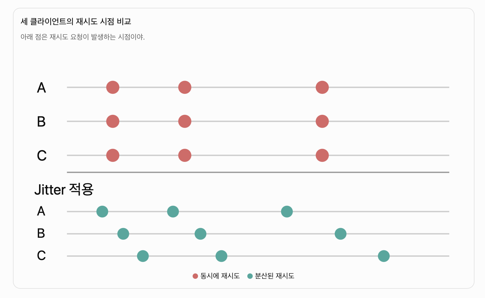

# Timeout, Retry, Backoff, Jitter 정리

> Marc Brooker의 [「Timeouts, retries, and backoff with jitter」](https://builder.aws.com/content/3EumjoZascWd1oZiEgL8ORlv3qE/timeouts-retries-and-backoff-with-jitter)를 바탕으로, 제공된 메모를 재구성한 학습 문서다. AWS 원문의 원칙과 아래의 Jenkins·Ansible 적용 예시는 구분해서 읽는다.

## 한눈에 보기

분산 시스템에서 원격 호출은 네트워크 지연, 일시적인 서버 장애, 과부하로 실패할 수 있다. 다음 네 가지 설정은 실패를 견디는 데 도움이 되지만, 재시도가 부하를 증폭하지 않도록 **횟수와 총 소요 시간을 제한**해야 한다.

| 개념 | 결정할 질문 | 역할 |
| --- | --- | --- |
| Timeout | 한 요청을 언제 포기할까? | 끝나지 않는 요청이 자원을 점유하는 시간을 제한한다. |
| Retry | 어떤 실패를 몇 번 다시 시도할까? | 일시적인 실패가 복구될 기회를 준다. |
| Backoff | 재시도 사이에 얼마나 기다릴까? | 실패한 서버에 요청을 즉시 다시 몰아넣지 않는다. |
| Jitter | 여러 호출자의 시도를 어떻게 분산할까? | 같은 시각에 재시도가 집중되는 현상을 줄인다. |

## 1. Timeout: 측정값에서 출발하기

Timeout이 너무 길면 장애를 늦게 감지하고 연결·스레드 같은 자원을 오래 잡는다. 너무 짧으면 정상 요청까지 실패로 판단해 불필요한 재시도를 만든다.

AWS 원문은 같은 리전 안의 서비스 호출에서 먼저 허용할 **거짓 타임아웃 비율**을 정하고, 그 비율에 대응하는 하위 서비스 지연 백분위수를 출발점으로 삼는다. 예를 들어 0.1%를 허용한다면 p99.9를 살펴본다. `p99.9 = 800ms`라면 관측 요청의 약 99.9%가 800ms 이내에 끝났다는 뜻이다. 다만 이 수치와 타임아웃을 기계적으로 같게 설정하지는 않는다. 인터넷 구간의 네트워크 지연, 새 연결 수립, TLS 핸드셰이크, 지연 분포의 변화도 반영해야 한다.

원문에는 약 20ms로 설정한 타임아웃이 배포 직후 새 서버와의 보안 연결을 처음 맺을 때만 발생한 사례가 나온다. 연결을 미리 만들어 트래픽을 받기 전에 준비시키는 방식으로 해결했다. 배포 직후의 초기화 비용은 평상시 응답시간 측정만으로 드러나지 않을 수 있다.

> **측정 순서:** 정상 상태와 배포 직후의 응답시간을 따로 기록하고, 연결·요청 타임아웃이 각각 어느 구간을 포함하는지 확인한 뒤 값을 정한다.

## 2. Retry: 회복을 돕기도, 장애를 키우기도 한다

일시적인 네트워크 오류나 서버 재시작 중의 실패는 잠시 뒤 성공할 수 있다. 반면 동일한 잘못된 요청을 반복하거나, 이미 과부하인 서버에 모든 클라이언트가 즉시 재시도하면 부하가 더 커진다.

| 상황 | 기본 판단 |
| --- | --- |
| 순간적인 연결 오류, 일시적인 서버 오류 | 제한된 횟수로 재시도를 고려한다. |
| 잘못된 요청을 의미하는 오류 | 같은 요청의 반복으로 해결되는지 먼저 확인한다. |
| 과부하·지속적인 실패 | 재시도가 회복을 방해하는지 확인하고 총량을 제한한다. |
| 상태를 변경하는 요청 | 중복 실행의 부작용을 먼저 확인한다. |

요청 100개가 모두 실패하고 각 요청을 **추가로 3회** 재시도하면 최대 400개가 된다. 여러 계층이 각각 재시도할 때 증폭은 곱셈으로 커진다. AWS 원문의 예시인 `3^5 = 243`은 **5개 계층에서 각 계층이 총 3회 시도**할 때의 최대치다. 재시도는 가능한 한 한 계층에서 통제하고, 횟수 또는 전체 시간 예산을 정해야 한다.

### 멱등성 확인

타임아웃은 요청이 서버에 도착하지 않았다는 뜻이 아니다. 서버가 작업을 완료했지만 응답만 유실됐을 수도 있다. `GET /health`처럼 읽기 전용인 호출은 보통 반복하기 쉽지만, 주문 생성이나 결제 요청을 그대로 반복하면 중복 처리될 수 있다. 상태 변경 API에는 멱등성 키 같은 중복 방지 수단을 설계해야 한다. [AWS의 멱등성 설명](https://aws.amazon.com/builders-library/making-retries-safe-with-idempotent-APIs/)

## 3. Backoff와 Jitter: 재시도 시점을 조절하기

지수 백오프는 실패할수록 대기시간을 늘린다. 예를 들어 기본 대기 1초, 상한 10초라면 시도 사이의 대기는 `1 → 2 → 4 → 8 → 10초`가 된다. 상한을 둬도 계속 같은 주기로 재시도하면 부하가 지속되므로, **최대 시도 횟수와 총 시간 제한**도 필요하다.

```text
대기 상한 = min(최대 대기시간, 기본 대기시간 × 2^(재시도 순번 - 1))
```

여러 클라이언트가 동시에 실패하면 같은 백오프만으로는 다음 시도도 같은 순간에 몰릴 수 있다. Jitter는 대기시간에 무작위성을 더해 요청을 시간상으로 분산한다. AWS 원문은 정기 작업에도 분산을 적용하되, 주기 작업의 경우 호스트별로 **일관된 오프셋**을 사용하면 반복되는 부하 패턴을 추적하기 쉽다고 설명한다. [백오프와 Jitter의 추가 설명](https://aws.amazon.com/blogs/architecture/exponential-backoff-and-jitter/)



위 그림에서 빨간 점은 클라이언트 A·B·C의 재시도가 한꺼번에 몰리는 모습을, 초록 점은 Jitter를 적용해 재시도 시점이 분산된 모습을 나타낸다.

## 4. Jenkins·Ansible 배포 후 Health Check에 적용하기

일반 API 호출의 재시도와 배포 후 Health Check는 목적이 다르다. 배포 후 점검은 **새 앱이 준비될 때까지 기다리고, 준비되지 않으면 다음 배포 단계로 넘어가지 않는 것**이 목적이다. 앱 시작시간의 p95/p99, Health API 응답시간, 허용 가능한 배포 대기시간을 측정해 값을 정한다. 단일 배포 작업에서 몇 초 간격으로 준비 상태를 확인할 때는 고정 간격도 합리적이다. 여러 작업이 같은 대상에 동시에 요청한다면 Jitter를 검토한다.

```yaml
- name: Wait until Spring Boot is ready
  ansible.builtin.uri:
    url: http://127.0.0.1:8080/actuator/health
    status_code: 200
    timeout: 3
  register: health
  until: >-
    health.status | default(0) == 200 and
    health.json.status | default('') == 'UP'
  retries: 12
  delay: 5
```

위 예시는 Health API가 JSON `{"status":"UP"}`를 반환한다는 가정이다. `timeout: 3`은 각 HTTP 호출의 소켓 타임아웃이고, `delay: 5`는 시도 사이 대기시간이다. 현재 [Ansible의 `until` 문서](https://docs.ansible.com/projects/ansible-core/devel/playbook_guide/playbooks_loops.html)는 `retries: 12`를 **최초 시도를 포함한 최대 12회 시도**로 설명한다. 따라서 각 호출이 3초를 모두 쓰는 최악의 단순 계산은 `12 × 3초 + 11 × 5초 = 91초`이고, 실제로는 작업 실행 오버헤드가 더해질 수 있다. `uri.timeout`의 의미는 [모듈 문서](https://docs.ansible.com/projects/ansible/latest/collections/ansible/builtin/uri_module.html)에서 확인한다.

이 저장소의 [앱 역할](../../../practice/doyeon/ansible/roles/app/tasks/main.yml)은 직접 `/health`에 `retries: 12`, `delay: 5`를 적용한다. 배포 환경에서는 실제 시작시간과 응답시간을 측정한 뒤 타임아웃과 전체 대기 예산을 명시적으로 조정하는 것이 다음 단계다. 준비 확인이 끝나면 `/version`으로 **예상 릴리스와 인스턴스**까지 확인해야 잘못된 버전을 정상으로 판단하지 않는다.

## 실무 점검표

1. 정상·배포 직후 응답시간과 앱 준비 시간을 측정한다.
2. 호출별 타임아웃, 최대 시도 횟수, 전체 시간 예산을 정한다.
3. 재시도할 오류와 즉시 실패할 오류를 구분한다.
4. 상태 변경 요청의 멱등성을 확보한다.
5. 다수 클라이언트의 재시도에는 백오프와 Jitter를 적용하고, 재시도율을 관찰한다.
6. 배포 Health Check에서는 준비 상태뿐 아니라 버전·릴리스·인스턴스도 검증한다.

핵심은 재시도 횟수를 늘리는 것이 아니라, **실패의 성격과 서버 상태를 보고 제한된 비용 안에서 회복을 시도하는 것**이다.
