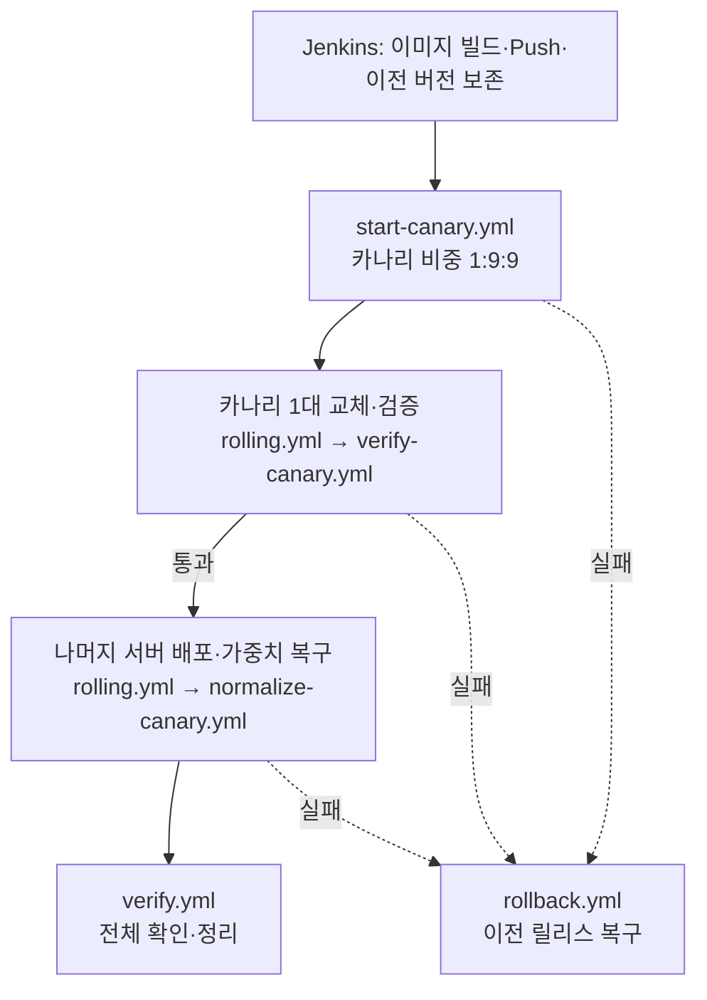

# 카나리·롤링 배포 흐름

이 문서는 Jenkins에서 `DEPLOY_MODE=canary-rolling`을 선택했을 때의 흐름을 설명한다. 중심은 Jenkins `Deploy` stage가 실행하는 [`canary-rolling.yml`](../../../practice/doyeon/ansible/playbooks/canary-rolling.yml)이다.

## 흐름 한눈에 보기



카나리를 먼저 한 대 교체하고 검증에 통과하면 나머지를 배포한다. 이전 정상 버전을 보존한 뒤 어느 배포·검증 단계든 실패하면 Jenkins `post.failure`가 `rollback.yml`을 실행한다. 보존이 끝나기 전 실패에는 되돌릴 앱 변경이 없으므로 자동 롤백하지 않는다.

## `canary-rolling.yml`: 다섯 플레이북을 차례로 실행

```yaml
- import_playbook: start-canary.yml
- import_playbook: rolling.yml
  vars:
    rollout_phase: canary
- import_playbook: verify-canary.yml
- import_playbook: rolling.yml
  vars:
    rollout_phase: remaining
- import_playbook: normalize-canary.yml
```

`import_playbook`은 다른 플레이북을 순서대로 포함한다. `rolling.yml`을 두 번 실행하면서 `rollout_phase`를 다르게 주고, 앞 단계가 실패하면 이후 단계는 진행하지 않는다.

## 배포 단계별 설명

### 1. `start-canary.yml` — 카나리 트래픽 비중 설정

대상은 `load_balancers`다. 먼저 카나리 서버와 가중치 설정이 유효한지 확인하고, Nginx upstream에 서버별 기본 줄(`server IP:PORT;`)이 정확히 하나씩 있는지 검사한다. 이미 가중치가 있거나 서버 줄이 누락되면 여기서 실패한다.

검사를 통과하면 `lineinfile`이 Nginx 설정 파일에 카나리 앱1 `weight=1`, 안정 서버 앱2·앱3 각각 `weight=9`를 쓴다. `nginx -t`로 설정을 검사한 다음 reload한다. 현재 비율은 `1:9:9`, 카나리 기대 비중은 약 5.3%다. 이 파일은 기존에 잘못 붙은 가중치를 자동 정리하지 않는다.

### 2. `rolling.yml` — 카나리 서버 한 대 배포

`rollout_phase=canary`로 실행하면 인벤토리의 `canary` 그룹, 현재 앱1만 대상으로 삼는다. 이 플레이북은 사전 검사부터 실제 교체까지 네 play를 실행한다.

| Play | 역할 |
| --- | --- |
| 앱 Health 사전 검사 | 기존 앱 서버의 직접 `/health`가 정상인지 확인한다. |
| Nginx upstream 사전 검사 | phase, 설정 문법, 서버별 활성 줄과 가중치를 확인한다. |
| 이미지 준비 | 새 이미지가 VM에 있는지 확인하고, 없으면 미리 가져온다. `serial: 1`로 한 VM씩 준비한다. |
| Drain·교체·복귀 | 대상 서버를 Nginx에서 제외하고 새 컨테이너를 검사한 뒤 정상일 때 다시 연결한다. |

마지막 play의 주요 순서는 다음과 같다.

1. 대상 서버 upstream 줄을 `down;`으로 바꾸고 LB에서 Nginx를 검사·reload한다.
2. `pause: 3`으로 기다린다. 이는 진행 중 요청을 위한 drain 대기이며 검증된 운영 기준은 아니다.
3. `app` role이 컨테이너를 교체하고 직접 `/health`, `/version`을 확인한다.
4. 검증에 통과하면 서버를 낮은 카나리 가중치로 upstream에 복귀시킨다.

컨테이너 교체 전에 실패하면 `rescue`가 upstream 복구를 시도한다. 교체 후 실패하면 검증되지 않은 서버를 트래픽에 다시 넣지 않고 중단하며, Jenkins 롤백으로 넘긴다.

### 3. `verify-canary.yml` — Nginx 경유 응답 확인

로드밸런서에서 Nginx를 거쳐 `/health`를 60회 호출한다. 각 응답이 정상인지, 카나리만 신규 릴리스이고 나머지는 이전 릴리스인지, 세 서버가 모두 응답했는지 확인한다. 카나리 응답 수는 전체의 20% 이하여야 통과한다.

이 검사는 라우팅과 Health 응답을 보는 짧은 순차 표본이다. 실제 사용자 트래픽을 장시간 관찰하거나 오류율·지연시간을 분석하지는 않는다.

### 4. `rolling.yml` — 나머지 앱 서버 배포

`rollout_phase=remaining`으로 다시 실행해 앱2와 앱3을 교체한다. `ROLLING_BATCH_SIZE=1`이면 한 대씩, `2`면 둘을 같은 배치로 처리한다. 기본값은 1이다. 각 서버를 제외하고 교체·검사한 뒤 정상일 때 `weight=9`로 복귀시킨다.

### 5. `normalize-canary.yml` — 가중치 복구

세 서버가 모두 예상한 가중치로 활성화됐는지 확인한 뒤 `lineinfile`로 `weight`를 제거한다. `nginx -t` 통과 후 reload하면 세 서버가 기본 동일 비중으로 요청을 받는다.

**현재 구현은 가중치를 1:9:9로 한 번 설정한 뒤 단계적으로 올리지는 않는다.** 카나리 확인과 나머지 롤링이 끝난 후 기본 비중으로 돌린다.

## 실패 복구와 마무리

| 파일 | 역할 |
| --- | --- |
| `prepare-rollback.yml` | 세 서버가 같은 정상 릴리스인지 확인하고, 각 VM의 실행 이미지 ID를 `doyeon-app:rollback`으로 보존한다. Jenkins가 이전 version/release도 저장한다. |
| `rollback.yml` | 서버를 한 대씩 Nginx에서 제외하고 보존 이미지로 복구한다. 직접 응답, LB 응답, 기본 upstream 설정까지 검사한다. 실패한 서버는 트래픽에서 제외하려고 시도한다. |
| `verify.yml` | 신규 배포 후 각 앱의 직접 `/health`, version/release/instance, Nginx 기본 upstream, LB 응답을 최종 확인한다. |
| `cleanup-rollback.yml` | 최종 검증 후 롤백 태그와 오래된 앱 이미지를 정리한다. 정리 실패는 배포 실패 대신 stage를 `UNSTABLE`로 남길 수 있다. |
| `bootstrap.yml` | 최초 설치용 별도 경로다. 이전 버전을 보존하지 않으므로 자동 롤백하지 않는다. |

Jenkins의 주요 stage는 **Build and validate → Push image → Preserve healthy release → Deploy → Verify all backends and Nginx → Clean up rollback images** 순서다. `Deploy` stage에서 선택한 `DEPLOY_MODE`에 대응하는 플레이북 하나를 실행한다.

## 같이 읽을 설정 파일

- `inventory/hosts.yml`: 앱 서버, 카나리, 나머지 서버, LB 그룹과 연결 주소를 정의한다.
- `inventory/group_vars/all.yml`: 포트, Nginx 경로, 카나리 가중치, 표본 수, Health Check timeout·retry·delay를 정의한다.
- `roles/app/tasks/main.yml`: 이미지 준비, 컨테이너 교체, 직접 Health Check와 릴리스 확인을 수행한다.
- `roles/app/tasks/pull.yml`: 이미지가 없으면 `docker pull`을 최대 3회, 5초 간격으로 재시도한다.
- `roles/nginx/tasks/main.yml`, `roles/nginx/handlers/main.yml`: 최초 Nginx 설정을 설치·검증하고 reload한다.
- `roles/nginx/templates/doyeon.conf.j2`: 인벤토리 서버로 upstream을 만들고 Nginx proxy timeout을 설정한다.
- `ansible.cfg`: 인벤토리·role 경로와 SSH host key 확인을 설정한다.

## 실 VM 검증 범위

2026-10-21 실제 VM 3대에서 정상 카나리→롤링 배포와 Health Check 장애 주입 후 Ansible 롤백을 확인했다. 자세한 요청 기록과 실험 수치는 [Timeout·Retry·Backoff·Jitter 및 검증 기록](01-timeouts-retries-backoff-jitter.md)에 있다. Jenkins Job 자체의 실행과 `post.failure` 자동 호출은 실제 Jenkins에서 검증하지 않았다.
